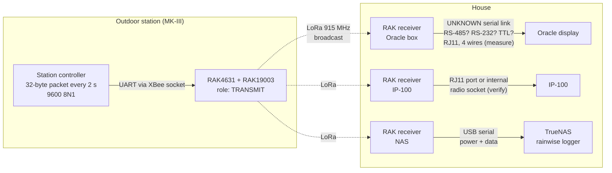
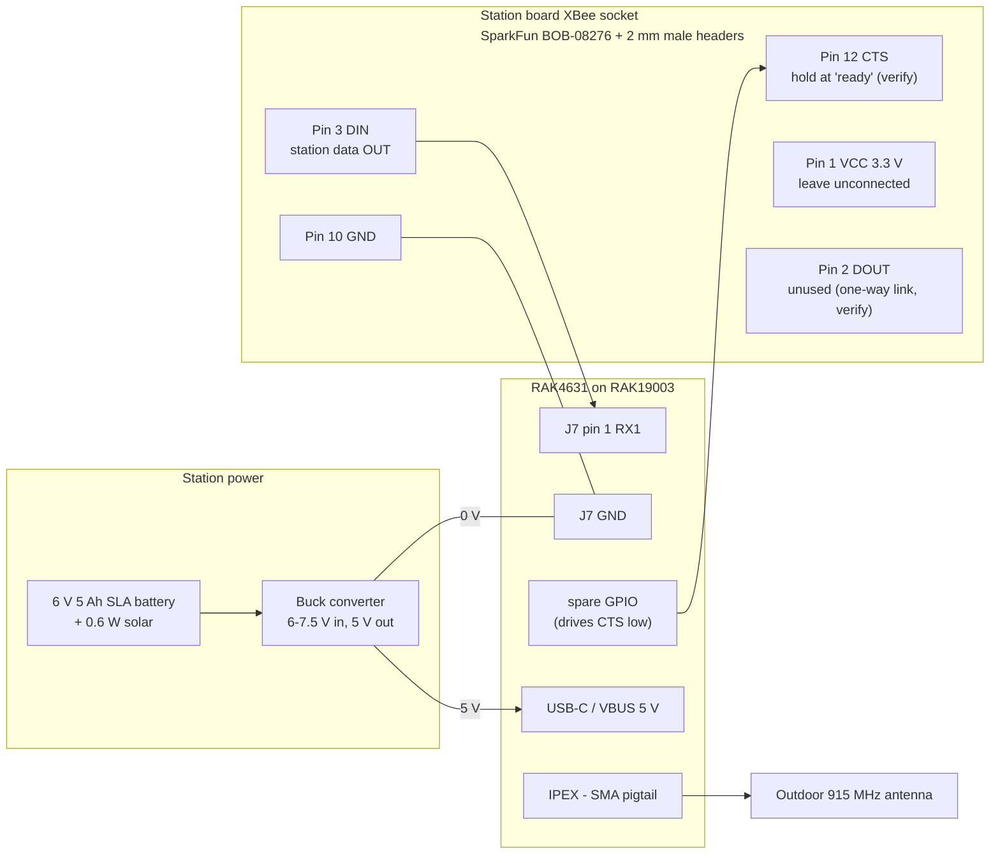
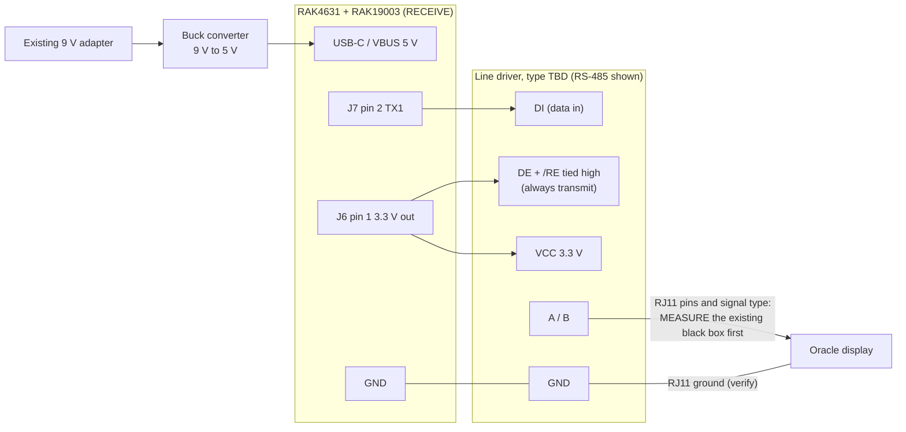
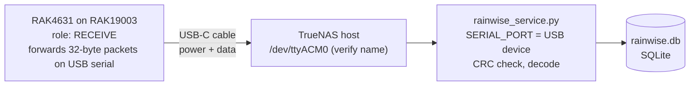

# Rainwise-Wireless-Info

MK3-LR XBee data information

## Introduction

Recently I had a power failure at home.  When the power returned my Oracle display stopped displaying data.  Having had to replace the wireless module long ago on another Rainwise I assumed it was the receiver.  I have reached out to 4x different support contacts for Rainwise and gotten no response.  So what does a reasonable person do??? I have no idea but this is what I did.

### Goals

1. Decode the MK3-LR wireless data stream.
2. Build a replacement transmitter/receiver pair using LoRa, so the Oracle display keeps working without the original XBee link.
3. Keep logging the data locally. The vendor has switched logging systems and the IP-100 may no longer be able to send data to their server.

## Inspection

I started visually inspecting pieces.  The display lit up but showed no data.  The receiver box showed a blinking light.  Something was receiving data but not getting to the display (initial evaluation).

I disassembled the receiver box.  Found what I am assuming is mostly a voltage level shifter and a Digi XBee3 module.

- Ordered an XBee breakout board from Amazon
- Connected the module to the breakout board and plugged it into my PC
- Data was being received

The serial data stream is 9600 8N1.  This also matched some info I had located about the Digi XBee3 module.

## Data

### Packet framing

|     Item      |                                               Value                                                |
| ------------- | -------------------------------------------------------------------------------------------------- |
| Serial        | 9600 baud, 8N1                                                                                     |
| Packet length | 32 bytes                                                                                           |
| Header        | `33 80 00` (bytes 1-3)                                                                             |
| Byte order    | Big-endian (high byte first), except bytes 17-18 (see below)                                       |
| Checksum      | CRC-16/XMODEM over bytes 1-30, stored big-endian in bytes 31-32                                    |
| Packet rate   | About every 2 seconds                                                                              |
| Live fields   | Wind speed, wind direction and rain counter update in every packet                                 |
| Slow fields   | Temperature, humidity, pressure, voltages and bytes 15-18 update once per minute (around :29 past) |

**Checksum details (confirmed):** CRC-16/XMODEM, polynomial `0x1021`, initial value `0x0000`, no input/output reflection, no final XOR. Calculated over bytes 1-30 including the header. Verified against every distinct packet captured so far.

These parameters come from the [CRC RevEng catalogue][crc-cat], the standard reference for identifying CRCs. Every entry has a "check" value: the CRC of the ASCII text `123456789`. For CRC-16/XMODEM that's `0x31C3`, and `rainwise_logger.py --test` checks it. The catalogue's [legend page][crc-legend] explains what each parameter (width, poly, init, refin, refout, xorout) means. It's a good starting point for learning how CRCs work.

```python
def crc16_xmodem(data: bytes) -> int:
    crc = 0
    for b in data:
        crc ^= b << 8
        for _ in range(8):
            crc = ((crc << 1) ^ 0x1021) & 0xFFFF if crc & 0x8000 else (crc << 1) & 0xFFFF
    return crc

# valid when crc16_xmodem(pkt[0:30]) == (pkt[30] << 8) | pkt[31]
```

### Byte map

Status key: ✅ confirmed against the IP-100 · ⚠️ partly understood · ❓ unknown

| Byte  |                  Field                   |                        Format                         |  Example   |   Result    | Status |
| :---: | ---------------------------------------- | ----------------------------------------------------- | :--------: | ----------- | :----: |
| 01-03 | Header                                   | constant                                              | `33 80 00` |             |   ✅    |
| 04-05 | Outside temperature                      | signed 16-bit, °F × 10                                |  `01 2B`   | 29.9 °F     |   ✅    |
|  06   | Humidity                                 | 8-bit, %                                              |    `4A`    | 74 %        |   ✅    |
| 07-08 | Barometric pressure                      | 16-bit, inHg × 1000                                   |  `64 9B`   | 25.755 inHg |   ✅    |
| 09-10 | Wind speed                               | 16-bit, mph × 10, live                                |  `00 1E`   | 3.0 mph     |   ✅    |
| 11-12 | Wind direction                           | 16-bit, degrees, live                                 |  `00 2D`   | 45°         |   ✅    |
|  13   | Rain tip counter                         | 8-bit, 0.01 in per tip, wraps at 256                  |    `3D`    | 61          |   ✅    |
|  14   | Rain check byte                          | 255 − byte 13                                         |    `C2`    |             |   ✅    |
|  15   | Station voltage (as shown by the IP-100) | 8-bit, V ≈ 0.0291 × value + 0.20                      |    `EB`    | 7.04 V      |   ✅    |
|  16   | Status flags                             | bit 0 = low-voltage flag? (`04` normal, `05` flagged) |    `04`    |             |   ⚠️   |
| 17-18 | Unknown analog value                     | 16-bit, **low byte first**                            |  `B4 B4`   | 46260       |   ⚠️   |
|  19   | Unknown                                  | `00` so far                                           |    `00`    |             |   ❓    |
| 20-21 | Voltage-like reading A                   | 16-bit, V × 100 (assumed)                             |  `02 C4`   | 7.08        |   ❓    |
| 22-23 | Voltage-like reading B                   | 16-bit, V × 100 (assumed)                             |  `02 A6`   | 6.78        |   ❓    |
| 24-30 | Unused                                   | all `00` so far                                       |  `00 ...`  |             |   ❓    |
| 31-32 | Checksum                                 | CRC-16/XMODEM                                         |  `AC 5E`   |             |   ✅    |

### Field notes

- **Temperature, humidity, pressure, wind direction:** match the IP-100 XML on every minute of the 2026-10-25 capture (e.g. 29.4 °F / 75 % / 26.272 vs 26.27 inHg / 337°).
- **Wind speed (09-10):** confirmed 2026-10-25 by spinning the anemometer by hand. Updates in every packet and matched the IP-100 value exactly at each step (1.2 → 2.8 → 0.0 mph). The 2024 mismatch (3.0 vs 5.4) was just a timing difference between packet and snapshot.
- **Wind gust:** not in the packet. The IP-100 tracked a 2.8 mph gust that equals the highest live speed sent, so gust is calculated by the receiving end from the live wind speed.
- **Wind direction (11-12):** confirmed 2026-10-25 by moving the tail: 337° → 135° → 157°, matching the IP-100 and updating live.
- **Rain (13-14):** confirmed 2026-10-25. About 4 oz of water poured into the gauge: byte 13 went `E1` → `E9` (8 tips) and the IP-100 daily rain went 0.00 → 0.08 in. The Oracle YTD went 10.95 → 11.03 in (+0.08). So **0.01 in per tip**, which matches Rainwise's own spec for their rain gauge ([Rainwise rain gauge][rw-gauge]). Byte 14 always equals 255 − byte 13 (`E1`/`1E`, `E9`/`16`, `3D`/`C2`), a simple check byte. Tips show up in the next packet, within about 2 s.
- **Rain counter wrap:** byte 13 is a running 8-bit count, not a daily or YTD total, and rolls over from 255 to 0. Rain amount = (new − old) mod 256 × 0.01 in. The station sends a packet every 2 s, so a wrap can't be missed in practice.
- **Byte 15 = IP-100 `station_volts` (confirmed 2026-10-26).** Over an 11-hour daytime log (669 minutes), every value of byte 15 matched exactly one `station_volts` value, and `V = 0.0291 × byte15 + 0.20`, rounded to 0.1 V, reproduced the IP-100 reading in all 669 minutes. It also gives 7.0 V for the 2024 sample (`EB` = 235), matching that XML. Several nearby slope/offset pairs (about 0.029-0.032 V per count) fit equally well, so the exact scale is still approximate; it works out to roughly 0.03 V per step, consistent with an 8-bit ADC reading the supply through a voltage divider ([SparkFun – voltage dividers][sparkfun-div]).
- **Is byte 15 really a battery voltage?** It rose smoothly from 216 to 234 (6.5 → 7.0 V) as the day warmed from 31 to 41 °F and fell back in the evening. Correlation with outside temperature is 0.98 ([Pearson correlation][pearson]). That could be the battery charging from the solar panel during the day, or the reading drifting with temperature ([correlation vs. causation][corr-cause]).
- **Sunlight comparison (2026-10-26): byte 15 does not follow sunlight on the panel.** The MK-III's panel faces true south, tilted 30° from vertical (60° from horizontal) for latitudes 22.5-55° N ([Rainwise MK-III User's Guide][rw-mk3]). A clear-sky model of sunlight on that panel (NOAA sun position + PVEducation direct-beam formula) peaks at solar noon, about 1:12 pm, but byte 15 peaked at 3:36 pm, together with air temperature. At 9:45 am the panel was already getting about half its peak sunlight while byte 15 hadn't moved from 216. Correlation with sunlight is only 0.34, against 0.98 with temperature, and after accounting for temperature what's left of byte 15 goes the *opposite* way to sunlight (−0.50). Conclusion: byte 15 is a voltage reading that drifts with temperature, not a sign of solar charging. Assumes a clear day and no shading of the panel.
- **Battery:** the MK-III uses a 6 V 5 Ah AGM sealed lead-acid battery with a 0.6 W solar panel ([Rainwise MK-III User's Guide][rw-mk3]). A multimeter reading on the battery, compared with byte 15 at the same minute on a cold night and a warm afternoon, will show whether byte 15 is the battery voltage plus temperature drift.
- **Byte 16:** `04` almost all the time. It switched to `05` (bit 0 set) for nine single minutes during the day, and every time bytes 20-21 and 22-23 had both dropped to about 6.5 V (average 6.50 / 6.49 V flagged vs. 7.04 / 7.01 V not flagged). Most likely a low-voltage warning bit. Not every reading that low was flagged, so the exact rule is unknown.
- **Bytes 17-18:** read low byte first (`byte18 × 256 + byte17`) they form a value around 43,700-48,800 (11-hour log) that moves opposite to bytes 20-23 (correlation about −0.4). Read high byte first, byte 17 looks like noise. Probably a raw ADC channel, possibly a reference voltage. Not wind gust: it only changes at the once-a-minute update and didn't react to the anemometer test.
- **Bytes 20-21 and 22-23:** originally labeled battery and second supply voltage because the first sample (7.08 V) happened to be close to the IP-100's 7.0 V. The daytime log shows the IP-100's value actually comes from byte 15. These two jump around a lot, 6.45-7.6 V with typical minute-to-minute changes of 0.2-0.26 V, far noisier than a real battery, and are not tied to temperature or time of day. They partly move together (correlation 0.53) and move opposite to bytes 17-18 (about −0.4). Possibly voltages measured under load (for example while the radio transmits) or raw charging-circuit readings. Not solar panel voltage: they read 6.7-7.1 V at night. Still unidentified.
- **Bytes 19 and 24-30:** zero in every packet of the 11-hour log. Probably slots for sensors this station doesn't have (solar radiation, UV, extra probes).
- **Pressure is station pressure.** The value in bytes 7-8 is the actual air pressure at the station, not corrected to sea level. At higher elevations it reads well below the ~30 inHg people expect. See [Sea-level pressure](#sea-level-pressure).
- **IP-100 `station_volts`:** solved, it's byte 15 (see above).
- **Header:** may contain a station ID or type. Can't test against a second station (the other Rainwise transmitter is not XBee).

### RAW samples

2024-03-23 (original sample, matches XML snapshot below):

```
33 80 00 01 2B 4A 64 9B 00 1E 00 2D 3D C2 EB 04 B4 B4 00 02 C4 02 A6 00 00 00 00 00 00 00 AC 5E
```

2026-10-25 night capture (calm, dry, dark), one packet per minute:

```
21:09:57  33 80 00 01 28 4B 66 9D 00 00 01 51 E1 1E D9 04 BC B3 00 02 C3 02 A2 00 00 00 00 00 00 00 66 18
21:10:29  33 80 00 01 28 4B 66 9D 00 00 01 51 E1 1E D8 04 80 B2 00 02 CF 02 B8 00 00 00 00 00 00 00 8D 1F
21:11:29  33 80 00 01 27 4B 66 A3 00 00 01 51 E1 1E D8 04 EE B1 00 02 D1 02 BB 00 00 00 00 00 00 00 31 82
21:12:29  33 80 00 01 26 4B 66 9D 00 00 01 51 E1 1E D9 04 B4 B3 00 02 C6 02 A8 00 00 00 00 00 00 00 34 F7
21:13:35  33 80 00 01 26 4B 66 A0 00 00 01 51 E1 1E D9 04 C2 B3 00 02 C3 02 A2 00 00 00 00 00 00 00 B5 BC
21:14:29  33 80 00 01 25 4B 66 9D 00 00 01 51 E1 1E D8 04 D6 B2 00 02 D3 02 C3 00 00 00 00 00 00 00 70 71
```

IP-100 at 21:14:22: 29.3 °F, 75 %, 26.27 inHg, wind 0.0 @ 337°, gust 0.0, rain 0.00, inside 64.0 °F, station_volts 6.5.

2026-10-25 hands-on test (anemometer spun, tail moved, ~4 oz water poured in):

```
                                         spd   dir   rain
21:28:29  33 80 00 01 1D 4B 66 9D 00 1C 01 51 E1 1E ...   2.8 mph  337°  IP-100 gust 2.8
21:29:45  33 80 00 01 1C 4B 66 A0 00 00 00 87 E1 1E ...   0.0      135°
21:29:50  33 80 00 01 1C 4B 66 A0 00 00 00 9D E1 1E ...   0.0      157°
21:30:05  ... 00 00 00 9D E3 1C ...                                       IP-100 rain 0.02
21:30:07  ... 00 00 00 9D E5 1A ...                                       0.04
21:30:09  ... 00 00 00 9D E7 18 ...                                       0.06
21:30:11  ... 00 00 00 9D E8 17 ...                                       0.07
21:30:13  33 80 00 01 1C 4B 66 A0 00 00 00 9D E9 16 D8 04 99 B2 00 02 CC 02 B1 00 00 00 00 00 00 00 6A FB   0.08
```

### Closest XML Snapshot (2024-03-23)

```XML
<?xml version="1.0" encoding="ISO-8859-1"?>
<!-- Weather and hardware paramters for the IP-100, min's, max's and accumulations are for the current day -->
<status>
 <hardware>
   <serial_number></serial_number>
   <firmware_version>2083</firmware_version>
   <clock>2024/03/23 12:06:48</clock>
   <station_volts>7.0</station_volts>
   <network>
     <MAC_address></MAC_address>
     <IP_address></IP_address>
  <subnet></subnet>
  <gateway></gateway>
   </network>
   <interval>1</interval>
   <base_units>English</base_units>
   <speed_units>mph</speed_units>
 </hardware>

 <weather>
 <temperature_outside>
  <current>29.9</current>
  <max>30.0</max>
  <min>26.3</min>
 </temperature_outside>

 <humidity>
  <current>74</current>
  <max>74</max>
  <min>67</min>
 </humidity>

 <pressure>
  <current>25.76</current>
  <max>25.95</max>
  <min>25.76</min>
 </pressure>

 <precipitation>
  <current>0.00</current>
 </precipitation>

 <wind>
  <speed>5.4</speed>
  <direction>45</direction>
  <gust_speed>7.2</gust_speed>
  <gust_direction>45</gust_direction>
 </wind>

 <temperature_inside>
  <current>60.0</current>
  <max>62.0</max>
  <min>60.0</min>
 </temperature_inside>
 </weather>
</status>
```

The IP-100 serves its status XML live at `http://<ip100-address>/status.xml` (replace with your IP-100's address on your network).

## Sea-level pressure

The station sends **station pressure**: the real air pressure where the barometer sits. Weather reports, airports and most weather websites show pressure **corrected to sea level**, so stations at different elevations can be compared. At a few thousand feet the difference is about 4 inHg, so an uncorrected reading looks "wrong" next to the local forecast even though it isn't.

Both tools add a `baro_sl_inhg` value alongside the raw `baro_inhg`. It uses the NWS **altimeter setting** formula, the same correction airports report in METARs ([NWS formula sheet][nws-alt]):

```
P  = station pressure in hPa (inHg × 33.8639)
h  = barometer elevation in meters (feet × 0.3048)
n  = 0.190284

NWS form:   A = (P − 0.3) × (1 + ((1013.25^n × 0.0065 / 288) × h / (P − 0.3)^n))^(1/n)
Same thing: A = ((P − 0.3)^n + k × h)^(1/n),   k = 1013.25^n × 0.0065 / 288 ≈ 8.42288e-5

sea-level inHg = A / 33.8639 + offset
```

What the constants are:

- **1013.25 hPa** (29.92 inHg): standard sea-level pressure.
- **0.0065 K/m**: standard temperature lapse rate (temperature drops 6.5 °C per km of height).
- **288 K** (15 °C): standard sea-level temperature, rounded. The exact standard-atmosphere value is 288.15 K; using it changes the result by about 0.002 inHg.
- **n = 0.190284**: comes from the physics of the standard atmosphere (lapse rate × gas constant ÷ (gravity × molar mass of air)).
- **0.3 hPa**: a small allowance NWS uses because the barometer reading isn't taken at exactly the reference height.

Because it uses the *standard* atmosphere instead of today's actual temperature, it doesn't swing with outside temperature. That's the main difference from "mean sea-level pressure" (MSLP), which uses the station's recent temperatures and can be unreliable at high elevations ([NWS pressure definitions][nws-defs]).

**Setup:**

1. Find the elevation of the barometer itself, in feet (the Oracle display or IP-100 box, wherever the pressure sensor is, not the ground at the mast). A GPS, a topo map or an online elevation lookup works.
2. Logger: `--elevation-ft <feet>` or set `RAINWISE_ELEVATION_FT`. Service: `ELEVATION_FT` in `docker-compose.yml`.
3. Calibrate: compare `baro_sl_inhg` with the altimeter setting from the nearest airport METAR on a calm day with steady pressure. In a METAR the altimeter setting is the `A` group, e.g. `A3028` = 30.28 inHg ([METAR format][metar]). ASOS stations send their hourly report a few minutes before the top of the hour, usually at :53 ([NWS observations FAQ][nws-obs]), so compare readings from that minute. Put the difference in `--baro-offset` / `BARO_OFFSET`. Small differences (±0.03 inHg) are normal sensor tolerance.

The elevation is kept out of the repo on purpose: it's a setting, not a value in the code. With elevation `0` no correction is applied.

Raw station pressure is always stored too, so the correction can be redone later if the elevation or offset changes.

## Tools

### `rainwise_logger.py` (testing)

Reads the XBee breakout over USB, checks the CRC, decodes the known fields, polls the IP-100 XML at the same moment, and writes one CSV row per packet. Includes a `changed_bytes` column listing which byte positions differ from the previous packet.

```
pip install pyserial
python rainwise_logger.py --test                 # decode the built-in sample
python rainwise_logger.py --port COM5 --xml-url http://<ip100-address>/status.xml
python rainwise_logger.py --port COM5 --no-xml   # radio only
python rainwise_logger.py --port COM5 --elevation-ft <feet> --baro-offset <inHg>   # add sea-level pressure
```

### `rainwise_service.py` + `docker-compose.yml` (long-term logging)

Runs on the TrueNAS NAS as a custom Docker app and stores everything in SQLite (`rainwise.db`):

- `packets`: raw hex of every valid packet plus decoded fields, so history can be re-decoded later
- `ip100_xml`: IP-100 readings once a minute, plus the full XML

Inputs: XBee on USB serial, UDP port 5005 (for the future LoRa receiver, one 32-byte packet per datagram), and the IP-100 XML. Each can be turned off in the compose file.

Only one program can open the serial port at a time. While testing on the PC, run the container with `SERIAL_PORT: ""` so it still logs the XML.

## Test plan

|                                                                           Test                                                                            | Status |                                                   Result                                                    |
| --------------------------------------------------------------------------------------------------------------------------------------------------------- | :----: | ----------------------------------------------------------------------------------------------------------- |
| Connectivity (port, self-test, live data, XML)                                                                                                            |   ✅    | All passed 2026-10-25                                                                                       |
| Night baseline capture                                                                                                                                    |   ✅    | Confirmed CRC, 1-minute update of slow fields, ruled out solar on 22-23                                     |
| Rain: pour water in the gauge                                                                                                                             |   ✅    | Byte 13 = tip counter, 0.01 in/tip; byte 14 = 255 − byte 13                                                 |
| Wind: spin the anemometer, move the tail                                                                                                                  |   ✅    | 09-10 and 11-12 confirmed, live; gust is calculated downstream                                              |
| Daytime capture: compare 15, 17-18, 20-23 in sun vs. night                                                                                                |   ✅    | 11 h log 2026-10-26: byte 15 = IP-100 station volts; byte 16 bit 0 = low-voltage flag?; 20-23 still unknown |
| Sunlight model vs. byte 15 (panel true south, 60° tilt)                                                                                                   |   ✅    | Byte 15 follows temperature, not sunlight                                                                   |
| Multimeter: measure station battery and solar panel, note the minute, compare with bytes 15, 20-21, 22-23 (cold night and warm afternoon)                 |   ⬜    |                                                                                                             |
| Sea-level pressure: verify elevation with GPS, compare with nearest airport at :53 past the hour on several calm days, set offset                         |   ⬜    | First comparison ~0.07 inHg high                                                                            |
| Receiver: check whether anything is ever sent back to the station (XBee DIN pin)                                                                          |   ⬜    |                                                                                                             |
| XBee config: read both XBees in XCTU; confirm `AP` = 0 (transparent mode), note `BD` (baud), `D6`/`D7` (RTS/CTS flow control) and sleep settings          |   ⚠️   | Receiver done 2026-10-26: transparent, 9600 8N1, CTS on, 802.15.4. Station still to read                    |
| Station side: tap the station XBee's DIN pin (pin 3) with a 3.3 V USB-serial adapter and confirm it carries the same 32-byte packets the receiver outputs |   ⬜    |                                                                                                             |
| Receiver to display: capture the RS-485 link and compare with the XBee output (same bytes, or re-formatted?)                                              |   ⬜    |                                                                                                             |

## XBee configuration

Read from the **receiver's** XBee with XCTU (read only, nothing written):

|      Setting       |         Value          |                                                                                            Meaning                                                                                            |
| ------------------ | ---------------------- | --------------------------------------------------------------------------------------------------------------------------------------------------------------------------------------------- |
| Product family     | XB3-24                 | XBee 3 hardware, 2.4 GHz                                                                                                                                                                      |
| Function set       | Digi XBee3 802.15.4 TH | Simple point-to-point/star protocol (not Zigbee or DigiMesh), through-hole module                                                                                                             |
| Firmware (`VR`)    | 2006                   |                                                                                                                                                                                               |
| `AP`               | 0                      | **Transparent mode**: serial bytes pass through unchanged ([AP][xbee-ap])                                                                                                                     |
| `BD` / `NB` / `SB` | 3 / 0 / 0              | 9600 baud, no parity, 1 stop bit                                                                                                                                                              |
| `D6`               | 0                      | RTS flow control off: the XBee outputs data whether or not the host is ready                                                                                                                  |
| `D7`               | 1                      | CTS flow control on (factory default) ([D7][xbee-d7])                                                                                                                                         |
| `SM`               | 0                      | No sleep                                                                                                                                                                                      |
| `RO`               | 3                      | Packetization timeout: sends after 3 character times of silence (factory default) ([RO][xbee-ro])                                                                                             |
| `DH` / `DL`        | 0 / 0                  | 16-bit addressing; the receiver doesn't appear to transmit anything ([802.15.4 addressing][xbee-addr])                                                                                        |
| `MY`               | 0                      | Receiver's own 16-bit address (factory default). The station's `DL` should be 0 (sent to this receiver, with automatic acknowledgments and retries) or `FFFF` (broadcast, no acknowledgments) |
| `EE`               | 0                      | No encryption                                                                                                                                                                                 |

The network ID (`ID`) and channel (`CH`) are kept out of this public document on purpose. With encryption off, anyone nearby with an XBee on the same ID and channel could read the station's packets or send fake ones to the display.

**Several receivers can listen at once.** Three XBee receivers (the Oracle display, the IP-100 data logger and the original receiver box's XBee on a USB breakout) all receive the station at the same time. So the station either broadcasts (`DL` = `FFFF`) or all receivers share address 0. Either way, adding another listening XBee (for example on the NAS) works in practice.

Still to read: the same settings from the **station's** XBee, especially `AP`, `D7`, `RO`, `MY` and `DL`. If the station XBee is also `AP` = 0, the data path from the station's microcontroller to the receiver output is unmodified.

## Receiver to Display Pinout

- 4 wires on an RJ11 connector
- 9 V power supply into the black box
- **Signal type NOT confirmed.** RS-485 is a guess: Rainwise uses it on other products (its Modbus stations), but nothing confirms it for this link. It could also be RS-232 or plain logic-level (TTL) serial. The 4 wires might also include power for the display.

### Identifying the link with a meter

Box powered and connected to the display. First find ground: the RJ11 pin with 0 Ω (continuity) to the minus side of the 9 V adapter, with power off. Then, powered, measure every other pin to that ground. Because packets arrive every 2 s, an analog meter's needle will twitch on data lines, which is a quick way to spot them.

|                                             What you see (each pin to ground)                                             |                 Likely link                  |
| ------------------------------------------------------------------------------------------------------------------------- | -------------------------------------------- |
| A steady ~9 V (or similar) that doesn't twitch                                                                            | Power passed to the display, not data        |
| **Two** pins both sitting somewhere around +1 to +4 V, a few hundred mV apart, twitching in opposite directions every 2 s | RS-485 / RS-422 (differential pair, A and B) |
| **One** pin sitting **negative** (about −3 to −15 V) and twitching                                                        | RS-232 (idles at "mark", which is negative)  |
| **One** pin sitting at +3.3 V or +5 V and dipping/twitching                                                               | Logic-level (TTL/CMOS) serial, idles high    |

Then confirm by capturing the data with the matching adapter (USB-RS485, USB-RS232, or a 3.3/5 V USB-serial adapter, or a logic analyzer on single-ended lines) at 9600 8N1, and check whether it carries the same 32-byte packets as the XBee.

References: RS-232 mark is −3 to −15 V and logic-level serial marks at the supply voltage ([Gumstix – Serial voltages][serial-volts]); logic-level thresholds ([SparkFun – Logic Levels][sf-logic]); RS-485 signal levels, termination and idle "failsafe" biasing ([TI RS-485 Design Guide][ti-485]); Rainwise's RS-485/Modbus products ([Fondriest – Rainwise MK-III Modbus][rw-modbus]).

## LoRa replacement plan

- **Transmitter:** read the 32-byte packets from the station's controller at 9600 8N1 and send them over LoRa. Only the framing (header, length, CRC) is needed, not the full decode.
- **Rate:** wind speed, direction and rain change in every 2-second packet, and the display calculates gusts from those live values. So the link should forward every packet, or at least every packet that changed. A 32-byte packet at SF7 / 125 kHz / CR 4/5 takes about 70 ms on air, so one every 2 s is roughly 3.5 % of the channel, well within LoRa limits. Sending once a minute would lose gusts. Airtime is calculated with the formula in the Semtech SX1276 datasheet ([Semtech forum thread][lora-toa], [TTN airtime spreadsheet][ttn-airtime]); higher spreading factors reach farther but take much longer.
- **Several receivers:** the display and the IP-100 each have their own XBee receiver today. A LoRa link either needs a LoRa receiver for each of them, or a single LoRa receiver in the house that re-broadcasts the packets on a local XBee using the original network settings, so the display and IP-100 keep working unchanged.
- **Receiver (ESP32 + LoRa):** check the CRC, write the original packet to the Oracle display port so it sees the same stream as before, and forward the packet over Wi-Fi (UDP 5005) to the NAS logger.
- **Hardware notes:** the XBee runs on 3.3 V, so a 3.3 V LoRa board can share its power and UART pins. Check whether the boards use the XBee's sleep or reset lines.

### Goals and hardware options

Goals, in order: **distance**, then **cost and easy sourcing**, using standard off-the-shelf boards instead of a custom board (the original XBee base board has already failed once).

**Why LoRa helps with distance.** The current radio is a standard XBee 3: +8 dBm, −103 dBm receiver sensitivity, up to 1200 m line of sight ([XBee 3 datasheet][xbee3-ds]). An SX1262 LoRa board like the CubeCell transmits at about +22 dBm and receives down to −124 dBm (SF7) to −135 dBm (SF12) at 125 kHz bandwidth ([HTCC-AB01 manual][cubecell-manual]). That's roughly 35-50 dB more link budget. In free space every 6 dB doubles the range ([free-space path loss][fspl]), so even after the US bandwidth rule below, it's many times the current range.

**Option A: Heltec CubeCell HTCC-AB01 (two on hand).** ASR650x Cortex-M0+ with an SX1262 radio, Arduino-programmable ([PlatformIO board list][pio-cubecell]). One UART, 3.5 µA deep sleep, about 10 mA receiving, 70-105 mA transmitting at 10-20 dBm, onboard lithium battery charging and a 5.5-7 V solar input ([HTCC-AB01 manual][cubecell-manual]; [HTCC-AB01 V2 page][cubecell-v2]).
- Average power at the station would be similar to or lower than the XBee (17 mA receive, 40 mA transmit ([XBee 3 datasheet][xbee3-ds])), since a 32-byte packet every 2 s is only a few percent transmit time.
- **Caveats:**
  - Heltec has **discontinued** the CubeCell series because the ASR6502 chip reached end of life ([HTCC-AB01 V2 page][cubecell-v2]). Fine for these two boards, but not for long-term spares; keep the firmware simple so it ports to another SX1262 board.
  - Rated **−20 to 70 °C** (−4 to 158 °F) ([HTCC-AB01 manual][cubecell-manual]). Cold winter nights can go below that, and lithium cells shouldn't be charged below freezing, so at the station it's safer to power it from the station's 3.3 V supply (3V3 pin, 2.7-3.5 V, 150 mA or more) than from its own lithium battery.
  - Must be checked: the board's frequency variant (the 863-928 MHz version is needed for US 915 MHz), and whether the station's 3.3 V regulator can supply the ~105 mA transmit peaks (the XBee only needs 40 mA).
- **Station connection without a custom board:** a SparkFun XBee breakout ([BOB-08276][sf-xbee-bob]) with 2 mm male headers ([PRT-10112][sf-2mm-header]) plugs into the station's XBee socket and brings the pins out to 0.1" spacing for jumper wires. Wire VCC (pin 1), GND (pin 10), the station's data out on DIN (pin 3) to the CubeCell's RX, and hold CTS (pin 12) in its "ready" state if the station uses flow control.
- **House end:** the CubeCell has no Wi-Fi and only one UART (shared with its USB port), so a board like the Heltec WiFi LoRa 32 V3 (ESP32-S3 + SX1262, US915 ([ESPHome device page][heltec-v3])) may suit the house side better: receive LoRa, re-send on a local XBee for the display and IP-100, and send UDP to the NAS. (Update: the CubeCells are going to a different project; see the RAK4631 plan below.)

**Board-independent approach (recommended, since CubeCells can no longer be bought).** Write the firmware with [RadioLib][radiolib], an Arduino library that drives SX126x, SX127x, LLCC68 and RFM9x radios on ESP32, nRF52, RP2040 and CubeCell boards. The same sketch then moves to whatever SX1262 board is easy to buy later if the RAK4631 is ever discontinued. Any two boards using the same LoRa settings (frequency, bandwidth, spreading factor, coding rate, sync word) can talk to each other, whatever the brand.

Current candidates:
- **Station: RAKwireless RAK4631(H)** WisBlock core (nRF52840 + SX1262; the H version covers US915), plugged into a standard WisBlock base board. Rated **−40 to +85 °C**, 2 µA sleep, 17 mA receiving, 92-125 mA transmitting at 17-20 dBm, two UARTs, 2.0-3.6 V supply, FCC certification document published ([RAK4631 datasheet][rak4631]).
- **House: Heltec WiFi LoRa 32 V3** (ESP32-S3 + SX1262, US915 ([ESPHome][heltec-v3])) or **Seeed XIAO ESP32S3 + Wio-SX1262 kit** (862-930 MHz ([Meshtastic device page][xiao-wio])). Both have Wi-Fi for the NAS and spare UARTs for the local XBee re-broadcast; power use doesn't matter indoors.

**Option B, no programming: Ebyte E22-900T22D UART modules.** SX1262-based, about $8, 9600 8N1 transparent serial by default, M0/M1 pins select the mode, 3.3 V logic ([Mischianti E22 guide][e22-guide]; [Ebyte on Tindie][ebyte-tindie]). Closest thing to an XBee replacement: serial in, serial out. Still in production. Note the similar E220 series uses a different chip (LLCC68) and can't talk to SX126x/SX127x boards ([Mischianti E220 guide][e220-guide]).

### Chosen direction: RAK4631 everywhere

Plan: replace the station transmitter **and every receiver** with the same board, the RAK4631 on a RAK19003 mini base (WisBlock Mini Meshtastic Starter Kit, US915). One board type, one sketch (transmit or receive role chosen at build time), one set of spares. LoRa is a broadcast medium, so any number of receivers can listen to the one station.

**The three places a board goes:**

|    Location    |                                                         Today                                                          |                                                                Replacement                                                                |
| -------------- | ---------------------------------------------------------------------------------------------------------------------- | ----------------------------------------------------------------------------------------------------------------------------------------- |
| Station        | XBee 3 on the station board                                                                                            | RAK4631 transmitting, wired into the XBee socket via a SparkFun XBee breakout                                                             |
| Oracle display | External "black box": 9 V in, small chips (probably level shifting) and an XBee 3 on a base board, 4 wires out on RJ11 | RAK4631 receiving + a standard ready-made line driver matching the RJ11 link (type not yet confirmed), outputting the same signal on RJ11 |
| IP-100         | Radio built in; also has an RJ11 port for an external receiver                                                         | Either the same RAK receiver box on the RJ11 port, or a RAK4631 in place of the internal radio                                            |

**What we know about the IP-100's RJ11 port.** The IP-100 manual says "Current LR models have the radio receiver built into the IP-100" and "Legacy 418/433 MHz versions require an external radio receiver" ([IP-100 User's Guide][rw-ip100]). So the port was meant for the older receivers. Whether it accepts the LR 32-byte packets is unknown, and no pinout is published.

**Power.** The RAK19003 takes 5 V USB/VBUS (5.5 V max) or a 3.7 V lithium cell; its 3.3 V pin is an output ([RAK19003 datasheet][rak19003]). It can't be powered from an XBee socket's 3.3 V. Each location needs a small standard 5 V supply: a buck converter from the station's 6 V battery, from the black box's 9 V input, or a USB power supply indoors.

**Tests to do before building the receivers:**

1. **Oracle RJ11 link, with the black box running and connected.** Identify the signal type first; RS-485 is only a guess (see [Identifying the link with a meter](#identifying-the-link-with-a-meter)). Then capture the data with the matching adapter or a logic analyzer. Is it the same 32-byte packet at 9600 8N1, or re-formatted? This also shows whether the black box is the part that failed.
2. **IP-100 RJ11 port, with nothing plugged in.** Measure each pin to ground. If any pin carries a supply voltage, note it. Compare with the Oracle box's RJ11 pinout.
3. **Only if the two pinouts match and no pin conflicts:** try the Oracle's black box (self-powered from its 9 V) on the IP-100's RJ11 port and see whether the IP-100 shows data from it.
4. **Look inside the IP-100** (unplugged): if the built-in radio is an XBee in a socket, the same socket-adapter approach as the station works there too.

A standard 3.3 V RS-485 transceiver such as the MAX3485 ([Analog Devices MAX3485][max3485]) is available on cheap ready-made modules, which keeps the receiver boxes free of custom boards.

### Wiring diagrams

Anything marked **verify** still needs to be measured or confirmed before wiring. Diagrams are [Mermaid][mermaid], which GitHub draws directly from this file ([GitHub – creating diagrams][gh-diagrams]).

**1. System overview.** One transmitter, any number of receivers.



**2. Station.** The RAK board takes the station's serial output from the XBee socket and runs from its own 5 V supply. The socket's 3.3 V (pin 1) is left unconnected because the RAK19003's 3.3 V pin is an output, not an input ([RAK19003 datasheet][rak19003]). CTS (pin 12) is held in its "ready" state in case the station controller waits for it; XBee flow-control lines are normally active-low (verify).



**3. Oracle receiver box.** Replaces the black box. **The line driver depends on what the RJ11 link turns out to be** (see [Identifying the link with a meter](#identifying-the-link-with-a-meter)); an RS-485 module is drawn only as one possibility. If it is RS-485, the driver is always enabled because data only flows to the display. Which RJ11 pins carry what must come from measuring the existing box.



**4. NAS receiver.** Plugs into the NAS by USB; the logger service reads it as a serial port (the device name is usually `/dev/ttyACM0` for this kind of board, verify with `ls /dev/serial/by-id/`).



**US radio rules (FCC Part 15.247, 902-928 MHz).** A device must either frequency hop (at least 50 channels and no more than 0.4 s on any one in 20 s when the channel is under 250 kHz wide), or use digital modulation at least 500 kHz wide. Up to 1 W output with antennas up to 6 dBi ([47 CFR 15.247][fcc-15247]). A fixed-channel LoRa link at 125 kHz meets neither. With a programmable SX1262 board, the simple route is **500 kHz bandwidth** with a higher spreading factor to win back sensitivity. Check what the Ebyte modules can be set to before relying on them.

## References

**Pressure**

- [NWS – Altimeter Setting formula][nws-alt] (PDF): the formula used for `baro_sl_inhg`.
- [NWS Boulder – Pressure definitions][nws-defs]: station pressure vs. sea-level pressure vs. altimeter setting, in plain language.
- [NWS – Pressure Altitude formula][nws-palt] (PDF): companion sheet, the reverse problem (what altitude a pressure corresponds to).
- [Wikipedia – METAR][metar]: how to read airport weather reports, including the `A` (altimeter) group.
- [NWS Chicago – Weather observations FAQ][nws-obs]: when ASOS stations send their hourly reports.

**Checksum**

- [CRC RevEng – 16-bit CRC catalogue][crc-cat]: parameters and check values for CRC-16/XMODEM and its relatives.
- [CRC RevEng – Catalogue legend][crc-legend]: what each CRC parameter means.

**Radio and serial**

- [Digi – XBee 3 TP (module temperature) command][xbee-tp]: the XBee's built-in temperature sensor. It's read with an AT command and is not added to the data stream, which is why bytes 22-23 couldn't be XBee temperature.
- [Digi – AP (API Enable) command][xbee-ap]: `AP` = 0 means transparent mode, where the XBee passes serial bytes through unchanged.
- [Digi – D7 (DIO7/CTS) command][xbee-d7], [RO (packetization timeout)][xbee-ro], [XBee 802.15.4 addressing][xbee-addr]: the settings read from the receiver.
- [Digi – Through-hole pinout][xbee-pins]: DOUT pin 2, DIN pin 3, CTS pin 12, RTS pin 16, SLEEP_RQ pin 9 (from the XBee S2C guide; XBee 3 through-hole modules use the same 20-pin layout).
- [Digi – Transparent operating mode][xbee-transparent]: in transparent mode an XBee is a "serial line replacement", passing bytes through unchanged (this page is from the XBee 3 Cellular guide; the concept is the same on all XBee 3 modules).
- [TI – The RS-485 Design Guide (SLLA272)][ti-485]: differential signaling, termination, failsafe biasing.
- [Semtech forum – LoRa time-on-air calculation][lora-toa]: points to the airtime formula in the SX126x/SX1276 datasheets.
- [TTN forum – Spreadsheet for LoRa airtime calculation][ttn-airtime]

**Data analysis**

- [Wikipedia – Pearson correlation coefficient][pearson]: the "correlation" numbers used above (−1 to +1).
- [Mathwords – Correlation vs. causation][corr-cause]: why two things rising together (like byte 15 and temperature) doesn't prove one causes the other.
- [SparkFun – Voltage dividers][sparkfun-div]: how a circuit scales a higher voltage down to what an ADC can read, which is where a "volts per count" scale comes from.

**Hardware and software**

- [Rainwise – Rain gauge][rw-gauge]: 0.01 in per tip.
- [Rainwise – MK-III Weather Stations User's Guide][rw-mk3] (PDF): solar panel direction and tilt by latitude, battery spec.

**LoRa hardware and radio rules**

- [Heltec – HTCC-AB01 user manual][cubecell-manual] (PDF) and [HTCC-AB01 V2 page][cubecell-v2]: CubeCell specs, power options, end-of-life note.
- [PlatformIO – Heltec CubeCell platform][pio-cubecell]: Arduino support for the CubeCell boards.
- [Digi – XBee 3 datasheet][xbee3-ds] (PDF): current radio's power, sensitivity, range, current draw.
- [Mischianti – Ebyte E22 guide][e22-guide] and [E220 guide][e220-guide]: UART LoRa modules, modes and wiring.
- [ESPHome – Heltec WiFi LoRa 32 V3][heltec-v3]
- [RadioLib][radiolib]: board-independent Arduino radio library (supported modules and platforms in its README).
- [RAKwireless – RAK4631 datasheet][rak4631]: station-side candidate, −40 to +85 °C.
- [RAKwireless – RAK4631 Quick Start Guide][rak4631-qs]: Arduino setup; uploading a sketch replaces Meshtastic but keeps the bootloader.
- [RAKwireless – RAK19003 Mini Base Board datasheet][rak19003]: power inputs and limits, UART1 on header J7, temperature range.
- [Rainwise – IP-100 User's Guide][rw-ip100] (PDF): built-in LR receiver; external receiver only for legacy 418/433 MHz models.
- [Analog Devices – MAX3485][max3485]: 3.3 V RS-485/RS-422 transceiver used on many ready-made modules.
- [Meshtastic – Seeed XIAO ESP32S3 + Wio-SX1262][xiao-wio]
- [SparkFun – XBee breakout][sf-xbee-bob] and [2 mm XBee header][sf-2mm-header]: plugging into the station's XBee socket without a custom board.
- [47 CFR 15.247][fcc-15247] (PDF): US rules for 902-928 MHz (hopping or ≥500 kHz bandwidth, power, antenna gain).
- [Wikipedia – Free-space path loss][fspl]: why 6 dB more link budget doubles range.

**Sun position and sunlight**

- [NOAA – General Solar Position Calculations][noaa-sun] (PDF): sun position, equation of time, declination.
- [PVEducation – Intensity at sea level][pve-beam]: clear-sky direct beam formula.
- [PVEducation – Air mass][pve-am]
- [Sandia PVPMC – Basic solar position models][pvpmc-sun]
- [TrueNAS – Installing custom apps][truenas-apps]: the Install via YAML steps.

[nws-alt]: https://www.weather.gov/media/epz/wxcalc/altimeterSetting.pdf
[nws-palt]: https://www.weather.gov/media/epz/wxcalc/pressureAltitude.pdf
[nws-defs]: https://www.weather.gov/bou/pressure_definitions
[nws-obs]: https://www.weather.gov/lot/weather_observations_faq
[metar]: https://en.wikipedia.org/wiki/METAR
[crc-cat]: https://reveng.sourceforge.io/crc-catalogue/16.htm
[crc-legend]: https://reveng.sourceforge.io/crc-catalogue/legend.htm
[xbee-tp]: https://docs.digi.com/resources/documentation/digidocs/90002273/reference/r_cmd_tp.htm
[xbee-ap]: https://docs.digi.com/resources/documentation/digidocs/90002273/reference/r_cmd_ap.htm
[xbee-pins]: https://docs.digi.com/resources/documentation/digidocs/90001506/reference/r_pinouts_th_smt_s2c.htm
[xbee-d7]: https://docs.digi.com/resources/documentation/digidocs/90002273/reference/r_cmd_d7.htm
[xbee-ro]: https://docs.digi.com/resources/documentation/digidocs/90002258/reference/r_cmd_ro.htm
[xbee-addr]: https://www.digi.com/support/knowledge-base/xbee-802-15-4-addressing
[xbee-transparent]: https://docs.digi.com/resources/documentation/digidocs/90002258/concepts/c_mode_transparent.htm
[ti-485]: https://www.ti.com/document-viewer/lit/html/SLLA272D/GUID-46CBB394-E1DD-47D0-B4E2-118DFF92B3BB
[lora-toa]: https://forum.lora-developers.semtech.com/t/sx126x-time-on-air-calculation/127
[ttn-airtime]: https://www.thethingsnetwork.org/forum/t/spreadsheet-for-lora-airtime-calculation/1190
[rw-gauge]: https://rainwise.com/wired-rain-gauge
[truenas-apps]: https://apps.truenas.com/managing-apps/installing-custom-apps/
[pearson]: https://en.wikipedia.org/wiki/Pearson_correlation_coefficient
[xbee3-ds]: https://cdn.sparkfun.com/assets/4/d/b/9/3/XB3-24Z8UM_datasheet.pdf
[cubecell-manual]: https://resource.heltec.cn/download/CubeCell/HTCC-AB01/HTCC-AB01%20User%20Manual1.2pdf.pdf
[cubecell-v2]: https://heltec.org/project/htcc-ab01-v2/
[pio-cubecell]: https://docs.platformio.org/en/latest/platforms/heltec-cubecell.html
[fspl]: https://en.wikipedia.org/wiki/Free-space_path_loss
[sf-xbee-bob]: https://www.sparkfun.com/breakout-board-for-xbee-module.html
[sf-2mm-header]: https://sparkfun.com/products/10112
[heltec-v3]: https://devices.esphome.io/devices/heltec-wifi-lora-32-v3/
[e22-guide]: https://mischianti.org/ebyte-lora-e22-device-for-arduino-esp32-or-esp8266-specs-and-basic-usage-1/
[e220-guide]: https://mischianti.org/ebyte-lora-e220-llcc68-device-for-arduino-esp32-or-esp8266-specs-and-basic-use-1/
[ebyte-tindie]: https://www.tindie.com/products/ebyteiot/e220-900t22d-lora-wireless-uart-module/
[fcc-15247]: https://www.govinfo.gov/content/pkg/CFR-2017-title47-vol1/pdf/CFR-2017-title47-vol1-sec15-247.pdf
[radiolib]: https://github.com/jgromes/RadioLib
[serial-volts]: https://wiki.gumstix.com/index.php/Serial_voltages
[sf-logic]: https://learn.sparkfun.com/tutorials/logic-levels/all
[rw-modbus]: https://fondriest.com/rainwise-mk-iii-modbus-weather-stations.htm
[mermaid]: https://mermaid.js.org/
[gh-diagrams]: https://docs.github.com/en/get-started/writing-on-github/working-with-advanced-formatting/creating-diagrams
[rw-ip100]: https://rainwise.com/mwdownloads/download/link/id/399
[rak19003]: https://docs.rakwireless.com/product-categories/wisblock/rak19003/datasheet/
[rak4631-qs]: https://docs.rakwireless.com/product-categories/wisblock/rak4631/quickstart/
[max3485]: https://www.analog.com/en/products/max3485
[rak4631]: https://docs.rakwireless.com/product-categories/wisblock/rak4631/datasheet/
[xiao-wio]: https://meshtastic.org/docs/hardware/devices/seeed-studio/esp32-sx1262-kit/
[rw-mk3]: https://rainwise.com/mwdownloads/download/link/id/385
[noaa-sun]: https://gml.noaa.gov/grad/solcalc/solareqns.PDF
[pve-beam]: https://www.pveducation.org/equations/intensity-sea-level
[pve-am]: https://www.pveducation.org/pvcdrom/properties-of-sunlight/air-mass
[pvpmc-sun]: https://pvpmc.sandia.gov/modeling-guide/1-weather-design-inputs/sun-position/basic-solar-position-models/
[corr-cause]: https://www.mathwords.com/c/correlation_vs_causation.htm
[sparkfun-div]: https://learn.sparkfun.com/tutorials/voltage-dividers/all
