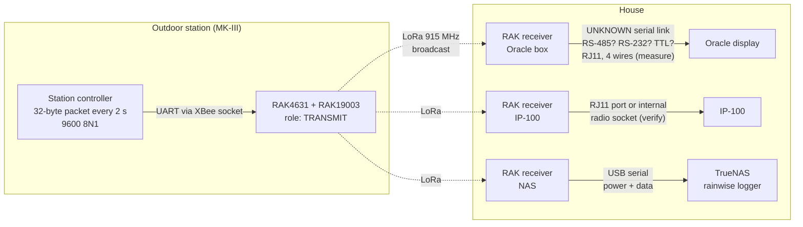
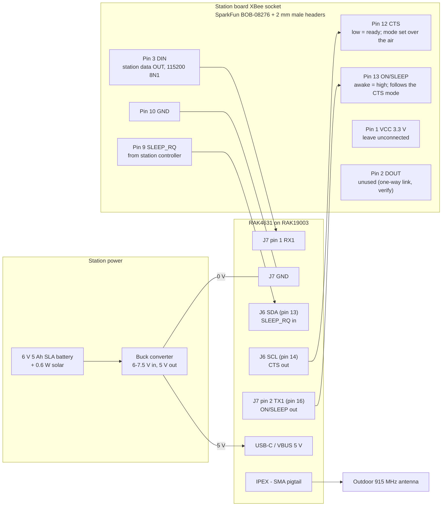
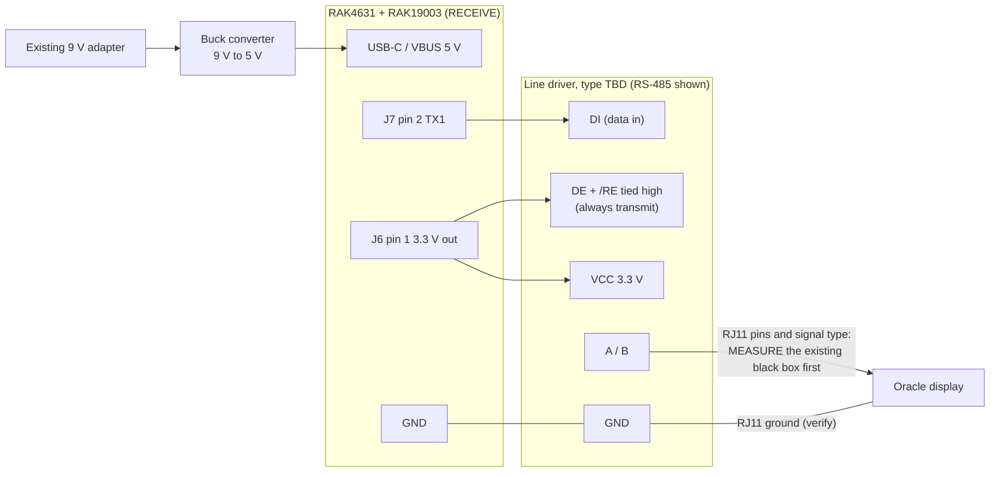
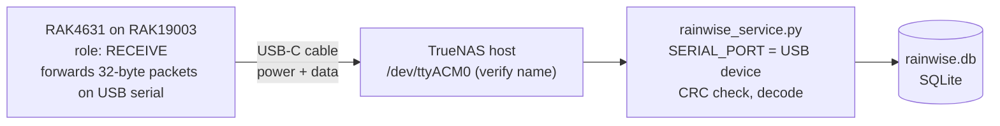

# Hardware: radios, display link and LoRa replacement

The XBee settings read so far, what is known about the Oracle display's RJ11 link, and the plan to replace the XBee radios with LoRa. The firmware is in [lora/README.md](../lora/README.md); open measurements are in the [test plan](../README.md#test-plan).

## XBee configuration

Read from both XBees with XCTU (read only, nothing written). The receiver was read 2026-10-26, the station (transmitter) 2026-10-29, with `MY`, `D8` and `D9` added 2026-11-08.

| Setting | Receiver | Station | Meaning |
| --- | --- | --- | --- |
| Product family | XB3-24 | XB3-24 | XBee 3 hardware, 2.4 GHz |
| Function set | Digi XBee3 802.15.4 TH | same | Simple point-to-point/star protocol (not Zigbee or DigiMesh), through-hole module |
| Firmware (`VR`) | 2006 | 2006 | |
| `AP` | 0 | 0 | **Transparent mode** on both ends: serial bytes pass through unchanged ([AP][xbee-ap]), so the receiver outputs exactly what the station's controller sent |
| `BD` / `NB` / `SB` | 3 / 0 / 0 | **7** / 0 / 0 | Receiver 9600 baud, **station 115200 baud**, both no parity and 1 stop bit ([BD][xbee-bd]). Each XBee's serial speed is local to it; the radio link carries the same bytes either way |
| `D6` | 0 | 0 | RTS flow control off: the XBee outputs data whether or not the host is ready |
| `D7` | 1 | 1 | CTS flow control on (factory default) ([D7][xbee-d7]) |
| `SM` | 0 | **1** | Receiver never sleeps. **Station uses pin sleep**: its controller puts the XBee to sleep through SLEEP_RQ (pin 9) between packets ([pin sleep][xbee-pinsleep]) |
| `RO` | 3 | 3 | Packetization timeout: sends after 3 character times of silence (factory default) ([RO][xbee-ro]) |
| `DH` / `DL` | 0 / 0 | 0 / **FFFF** | **The station broadcasts** (`DL` = `FFFF`): no acknowledgments or retries, and any number of receivers can listen ([802.15.4 addressing][xbee-addr]) |
| `MY` | 0 | 0 | Each XBee's own 16-bit address (factory default 0) |
| `D8` | not recorded | 1 | Pin 9 works as SLEEP_RQ (DTR/Sleep_Rq) |
| `D9` | not recorded | 1 | Pin 13 works as ON/SLEEP (Awake/nSleep indicator): the XBee drives it high while awake |
| `EE` | 0 | 0 | No encryption |
| `ID` / `CH` | private | same as receiver | Network ID and channel match on both ends (values kept private, see below) |

The network ID (`ID`) and channel (`CH`) are kept out of this public document on purpose. With encryption off, anyone nearby with an XBee on the same ID and channel could read the station's packets or send fake ones to the display.

**Several receivers can listen at once.** Three XBee receivers (the Oracle display, the IP-100 data logger and the original receiver box's XBee on a USB breakout) all receive the station at the same time, as expected from the station's broadcast (`DL` = `FFFF`). Adding another listening XBee (for example on the NAS) works.

**What the station settings mean for the LoRa replacement:**

- **115200 baud at the station.** The station's controller talks to its XBee at 115200, not 9600. The station-side RAK board must read UART1 at 115200 (the firmware does). A 32-byte packet takes under 3 ms at that speed.
- **Pin sleep.** In pin sleep, SLEEP_RQ (pin 9) high puts the XBee to sleep and low wakes it. When awake and ready, the XBee drives CTS (pin 12) low and ON/SLEEP (pin 13) high; asleep, CTS goes high and ON/SLEEP low ([pin sleep][xbee-pinsleep]; [pin signals][xbee-pins-802]; the CTS/ON/SLEEP behaviour is documented in Digi's [Zigbee guide][xbee-zb-pinsleep] and assumed to be the same here, **verify**). The station's controller probably wakes the XBee, waits for CTS low, sends the packet and puts it back to sleep. The firmware mimics this by default and can switch CTS to always-ready or not-driven over the air; its once-a-minute status message shows how often SLEEP_RQ wakes the radio, which answers which lines the controller uses without a logic analyzer (**verify** once installed). The station XBee's `D8` = 1 and `D9` = 1 (read 2026-11-08) mean both pins are active, but not whether the controller uses them. Two conclusions:
  - **The controller must drive SLEEP_RQ.** With `SM` = 1 and `D8` = 1, a SLEEP_RQ left high keeps the XBee asleep, so it would never transmit. The station has always transmitted, so the controller pulls pin 9 low to wake it. This supports mirror mode as the default (**verify** with the first status messages).
  - **The controller might wait for ON/SLEEP (pin 13) instead of CTS (pin 12).** Both say "awake and ready". Which one it reads is unknown (**verify**), so the station firmware drives both: ON/SLEEP comes from the RAK19003's TX1 pin (J7 pin 2), which the station doesn't need for serial output (added 2026-11-08, [lora/README.md](../lora/README.md#board-pins-rak4631)).

## Station main board

From photos taken 2026-11-08 (kept private because the backgrounds show the property):

- **Board:** silkscreen "©2014 RainWise Inc. P/N 08221110 Rev. 0, MKIII MSP430". The controller is a TI MSP430 microcontroller (U14, a 64-pin flat package; exact part not read). The board also has a JTAG header, a 5-position DIP switch, a "Status" LED (D3, the red light that blinks every 2 s), connectors for the PV panel, a switch and the battery (J5), two RJ-style sensor jacks (J1, J7) and the 3-pin "Ext Comms" connector (J3).
- **XBee socket:** two 10-pin 2 mm sockets, **J6** (right) and **J4** (left), between them the label "2.4GHz". The XBee sits with its antenna end **pointing down**: the outline's angled corners are at the bottom, and on the back of the board the square pad (pin 1) is at the bottom of J6. So J6 holds pins 1-10 (pin 1 at the bottom, pin 10 at the top) and J4 holds pins 11-20 (pin 11 at the top, pin 20 at the bottom). Pin 9 (SLEEP_RQ) is second from the top of J6; pin 12 (CTS) and pin 13 (ON/SLEEP) are second and third from the top of J4. The SparkFun breakout must go in the same way: its pin 1 at the bottom right.
- **Which socket pins are wired:** not visible. The board is conformally coated and the traces under the socket can't be followed in the photos, so whether the controller reads CTS (pin 12), ON/SLEEP (pin 13) or neither is still unknown (**verify**).

## Station "Ext Comms" connector

The station's main board has a 3-pin connector labelled "Ext Comms". Its purpose and pinout are undocumented. A plug-in connector would be an easier place to attach the LoRa board than the XBee socket, if it carries the same data.

First measurement (2026-11-08, station running, nothing plugged in, DC volts to the battery negative, RadioShack 22-807):

| Pin (as seen at the station) | Reading |
| --- | --- |
| Left | 0 mV |
| Middle | 30-50 mV, drifting while the probe was held there |
| Right | 0 mV |

No pin carries a supply voltage, and none sits at an idle UART level (logic high around 3.3 or 5 V) or an RS-232 idle level (−3 to −15 V). The drifting few tens of millivolts on the middle pin looks like an undriven (floating) line read by the meter's 10 MΩ input. Possible explanations, none confirmed: the port's driver is switched off until something is connected or the port is enabled in the station's settings; the middle pin is an input for an external device; or the port only transmits in bursts too short for the meter. Left and right reading 0 mV doesn't prove either is ground (an undriven line can also read 0 mV). The next check is resistance from each pin to the battery negative with the station off (**verify**), but it isn't urgent, because the XBee-socket install doesn't depend on it.

## Receiver to Display Pinout

- 4 wires on an RJ11 connector (standard telephone cable)
- 9 V AC adapter into the black box; **the Oracle display has no supply of its own and is powered from the black box over the telephone cable** (owner's observation: adapter → black box → cable → Oracle). So at least two of the four wires are power and ground, which leaves at most two for data: one signal plus ground, or a differential pair.
- **Signal type NOT confirmed, but the board photo (below) points to plain logic-level (TTL) serial.** RS-485 was the first guess, because Rainwise uses it on other products (its Modbus stations), but the board has no chip that could be an RS-485 or RS-232 transceiver.

### The receiver board (photo, 2026-11-11)

Owner's photo of the failed receiver box's board with the XBee removed (photo kept privately). Silkscreen: **"10300502-MK-III-LR Rx"**, board maker's mark "IMAG 94V-0", date code "29 18" (probably week 29 of 2018, **verify**). Everything on it:

| Ref | What it is | Notes |
| --- | --- | --- |
| U1 | XBee socket (two 10-pin 2 mm rows) | Takes the receiver XBee |
| U3 | **LP38691DT-3.3** (National/TI marking), 3.3 V low-dropout regulator, TO-252 | Powers the XBee from the 9 V input. Rated **2.7 to 10 V input**, 500 mA ([TI LP38691][lp38691]) |
| U4 | Tiny **6-lead** chip (SOT-23-6 size), marking not readable even in the full-resolution photo | The only logic chip on the board. With R1 (marked 103 = 10 kΩ) next to it and traces running toward the XBee socket and toward J2, it is most likely a single-gate buffer or level shifter between the XBee's data out and the RJ11 (**verify**: read the marking, trace the pins) |
| D2, R2 | Part with a clear body and a resistor in series | Probably an indicator LED (**verify**) |
| D1 | SOT-23 marked **KG5** = **MMBZ5230B, 4.7 V Zener diode** ([Diodes Inc. MMBZ52xxB datasheet][mmbz5230b], [SMD code database][smd-kg5]) | With R3 (marking not readable) and C1/C3 next to it, most likely a resistor-plus-Zener supply of about 4.7 V taken from the 9 V input (**verify**, see below) |
| R3, C1, C3 | Resistor and two capacitors around D1 | |
| C2 | Capacitor at the regulator | |
| J1 | DC barrel jack (9 V in) | Its center-pin trace runs **straight to J2**: the unregulated 9 V goes down the telephone cable to power the Oracle, confirming the owner's observation |
| J2 | Modular (RJ11-type) jack | To the Oracle |

What this means:

- **The data probably leaves the board at about 5 V logic (a hypothesis, verify).** The 4.7 V Zener suggests a second, roughly 5 V supply made from the 9 V, and the obvious user of it is U4. A 6-lead chip running from 3.3 V on one side and about 5 V on the other is how a single-bit level translator is used (for example TI's SN74LVC1T45, 1.65 to 5.5 V on each side, SOT-23-6 ([TI SN74LVC1T45][lvc1t45])). That is only one candidate until U4's marking is read. Measuring D1's voltage with the box powered and the data pin's idle level answers it.
- **The link is almost certainly single-ended logic-level serial.** An RS-485 transceiver needs at least an 8-lead package, and an RS-232 driver needs a charge pump with several capacitors ([TI RS-485 Design Guide][ti-485], [Gumstix – Serial voltages][serial-volts]). Neither is on the board; the only logic part is U4. Whether it drives 3.3 V or 5 V, and whether the data is inverted, is still to be measured (**verify**).
- **A LoRa replacement for this box is simple:** RAK19003 UART1 TX1 (3.3 V logic) into the same data pin, through a buffer if the Oracle needs 5 V, plus a buck converter from the same 9 V adapter. The 9 V continues straight to the Oracle, as it does today.
- **Possible cause of the failure (a guess, verify):** the box failed **after a power outage** (owner), so a surge when power came back is a reasonable suspect, and the regulator's 10 V input limit leaves little margin over a 9 V adapter. An unregulated wall adapter can measure well above its label with a light load. Measure the adapter's open-circuit voltage; if it is over 10 V, that may be what killed the board. For the replacement: choose a buck converter whose maximum input is well above the adapter's open-circuit voltage (most small off-the-shelf modules take far more than 9 V, **verify** the chosen module's rating), and plug the adapter into a surge protector or a UPS. The Oracle itself is fed the same raw 9 V and survived, so it is the box's 10 V regulator that has the least margin.

### Older unit: data-logger board (photos, 2025-03-06)

From the owner's older (non-LR, 418 MHz) setup: the data logger that its receiver box plugged into. Recorded because it shows what Rainwise used on the receiving side of a phone-cable link; it is a different generation, so it does **not** prove anything about the LR link. Board "RainWise Inc. 05269901", battery pack beside it.

| Ref | Marking | What it is |
| --- | --- | --- |
| U4 | DS80C323 | Dallas/Maxim 8051-family microcontroller (**verify** details from its datasheet) |
| U5 | EPROM, label "EPROM Contents Rainwise 1985-2007 OR2_CC47" | Firmware |
| U6 | CY62256 | 32 KB static RAM (logged data) |
| U3 | M74HC373 | 8-bit latch; the standard address latch of an 8051 with external memory (**verify**) |
| U2 | MM74HC02 | Four NOR gates (glue logic or signal inverting, **verify**) |
| (bottom) | MAX232N | RS-232 driver/receiver: 2 drivers and 2 receivers, single 5 V supply, receiver inputs accept ±30 V ([TI MAX232][max232]) |
| X1 | 3.6864 | 3.6864 MHz crystal, a standard frequency that divides exactly to common baud rates such as 9600 |

What it tells us (all **verify**): the MAX232 is most likely the logger's PC port. It has two receivers, though, so one might take the receiver box's data. Because its receivers accept anything from ±30 V down to plain 0/5 V logic, the old receiver box could have sent either. Tracing the phone jack's pins on this board to the MAX232 or the 74HC02 would show which, and it matters for the 418 MHz station later, not for the LR work now.

### Looking inside the black box

Use the spare ("busted") box for opening and tracing, so the Oracle keeps running. Its XBee works, so the fault is somewhere between the XBee and the display; finding the bad part is a bonus, not the goal.

1. Photograph the back of the board, and U4 and R3 close up (D1 is read: KG5); a phone's zoom or a cheap USB microscope can read the markings that the eye can't. Small surface-mount parts carry a short marking code instead of the full part number, so look the code up together with the package type (**verify** each match against the part's datasheet).
2. With power off, follow the copper (continuity beep) from the XBee socket's **DOUT pin 2** ([XBee pinout][xbee-pins]) to U4, and from U4 to the RJ11 pins. That confirms the data path.
3. Note which RJ11 pins connect to the 9 V input jack (power to the Oracle) and to ground.
4. Then do the powered measurements in the next section on the working box, connected to the Oracle.

A plug-in RJ11-to-screw-terminal adapter or a short cable with a cut end makes the pins much easier to probe than the connector itself.

### Identifying the link with a meter

Box powered and connected to the display. First find ground: the RJ11 pin with 0 Ω (continuity) to the minus side of the 9 V adapter, with power off. Then, powered, measure every other pin to that ground. Because packets arrive every 2 s, an analog meter's needle will twitch on data lines, which is a quick way to spot them.

|                                             What you see (each pin to ground)                                             |                 Likely link                  |
| ------------------------------------------------------------------------------------------------------------------------- | -------------------------------------------- |
| A steady ~9 V (or similar) that doesn't twitch                                                                            | Power passed to the display, not data        |
| **Two** pins both sitting somewhere around +1 to +4 V, a few hundred mV apart, twitching in opposite directions every 2 s | RS-485 / RS-422 (differential pair, A and B) |
| **One** pin sitting **negative** (about −3 to −15 V) and twitching                                                        | RS-232 (idles at "mark", which is negative)  |
| **One** pin sitting at +3.3 V or +5 V and dipping/twitching                                                               | Logic-level (TTL/CMOS) serial, idles high    |

Then confirm by capturing the data with the matching adapter (USB-RS485, USB-RS232, or a 3.3/5 V USB-serial adapter, or a logic analyzer on single-ended lines) at 9600 8N1, and check whether it carries the same 32-byte packets as the XBee.

References: RS-232 mark is −3 to −15 V and logic-level serial marks at the supply voltage ([Gumstix – Serial voltages][serial-volts]); logic-level thresholds ([SparkFun – Logic Levels][sf-logic]); RS-485 signal levels, termination and idle "failsafe" biasing ([TI RS-485 Design Guide][ti-485]); Rainwise's RS-485/Modbus products ([Fondriest – Rainwise MK-III Modbus][rw-modbus]).

## LoRa replacement plan

The list below is the original outline. The current design is under [Chosen direction](#chosen-direction-rak4631-everywhere), and the radio settings actually used (500 kHz bandwidth, not the 125 kHz in the airtime example) are in [lora/README.md](../lora/README.md#radio-settings).

- **Transmitter:** read the 32-byte packets from the station's controller at 9600 8N1 and send them over LoRa. Only the framing (header, length, CRC) is needed, not the full decode.
- **Rate:** wind speed, direction and rain change in every 2-second packet, and the display calculates gusts from those live values. So the link should forward every packet, or at least every packet that changed. A 32-byte packet at SF7 / 125 kHz / CR 4/5 takes about 70 ms on air, so one every 2 s is roughly 3.5 % of the channel, well within LoRa limits. Sending once a minute would lose gusts. Airtime is calculated with the formula in the Semtech SX1276 datasheet ([Semtech forum thread][lora-toa], [TTN airtime spreadsheet][ttn-airtime]); higher spreading factors reach farther but take much longer.
- **Several receivers:** the display and the IP-100 each have their own XBee receiver today. A LoRa link either needs a LoRa receiver for each of them, or a single LoRa receiver in the house that re-broadcasts the packets on a local XBee using the original network settings, so the display and IP-100 keep working unchanged.
- **Receiver (ESP32 + LoRa):** check the CRC, write the original packet to the Oracle display port so it sees the same stream as before, and forward the packet over Wi-Fi (UDP 5005) to the NAS logger.
- **Hardware notes:** the XBee runs on 3.3 V, so a 3.3 V LoRa board can share its power and UART pins. Check whether the boards use the XBee's sleep or reset lines.

### Goals and hardware options

Goals, in order: **distance**, then **cost and easy sourcing**, using standard off-the-shelf boards instead of a custom board (the original XBee base board has already failed once).

**Options considered** (details below):

| Option | Outcome |
| --- | --- |
| Heltec CubeCell HTCC-AB01 (two on hand) | Dropped: discontinued, rated only to −20 °C; the boards went to another project |
| Heltec WiFi LoRa 32 V3 or Seeed XIAO ESP32S3 + Wio-SX1262 (house end) | Not needed: a RAK4631 on USB feeds the NAS directly |
| Ebyte E22-900T22D UART modules | Kept as the no-programming fallback; 500 kHz setting not yet checked |
| RAKwireless RAK4631 + RAK19003 | **Chosen** for every location: −40 °C rating, standard kit, RadioLib support |

**Why LoRa helps with distance.** The current radio is a standard XBee 3: +8 dBm, −103 dBm receiver sensitivity, up to 1200 m line of sight ([XBee 3 datasheet][xbee3-ds]). An SX1262 LoRa board like the CubeCell transmits at about +22 dBm and receives down to −124 dBm (SF7) to −135 dBm (SF12) at 125 kHz bandwidth ([HTCC-AB01 manual][cubecell-manual]). That's roughly 35-50 dB more link budget. In free space every 6 dB doubles the range ([free-space path loss][fspl]), so even after the US bandwidth rule below, it's many times the current range.

**Option A: Heltec CubeCell HTCC-AB01 (two on hand).** ASR650x Cortex-M0+ with an SX1262 radio, Arduino-programmable ([PlatformIO board list][pio-cubecell]). One UART, 3.5 µA deep sleep, about 10 mA receiving, 70-105 mA transmitting at 10-20 dBm, onboard lithium battery charging and a 5.5-7 V solar input ([HTCC-AB01 manual][cubecell-manual]; [HTCC-AB01 V2 page][cubecell-v2]).
- Average power at the station would be similar to or lower than the XBee (17 mA receive, 40 mA transmit ([XBee 3 datasheet][xbee3-ds])), since a 32-byte packet every 2 s is only a few percent transmit time.
- **Caveats:**
  - Heltec has **discontinued** the CubeCell series because the ASR6502 chip reached end of life ([HTCC-AB01 V2 page][cubecell-v2]). Fine for these two boards, but not for long-term spares; keep the firmware simple so it ports to another SX1262 board.
  - Rated **−20 to 70 °C** (−4 to 158 °F) ([HTCC-AB01 manual][cubecell-manual]). Cold winter nights can go below that, and lithium cells shouldn't be charged below freezing, so at the station it's safer to power it from the station's 3.3 V supply (3V3 pin, 2.7-3.5 V, 150 mA or more) than from its own lithium battery.
  - Must be checked: the board's frequency variant (the 863-928 MHz version is needed for US 915 MHz), and whether the station's 3.3 V regulator can supply the ~105 mA transmit peaks (the XBee only needs 40 mA).
- **Station connection without a custom board:** a SparkFun XBee breakout ([BOB-08276][sf-xbee-bob]) with 2 mm male headers ([PRT-10112][sf-2mm-header]) plugs into the station's XBee socket and brings the pins out to 0.1" spacing for jumper wires. Wire VCC (pin 1), GND (pin 10), the station's data out on DIN (pin 3) to the CubeCell's RX, and hold CTS (pin 12) in its "ready" state if the station uses flow control.
- **House end:** the CubeCell has no Wi-Fi and only one UART (shared with its USB port), so a board like the Heltec WiFi LoRa 32 V3 (ESP32-S3 + SX1262, US915 ([ESPHome device page][heltec-v3])) may suit the house side better: receive LoRa, re-send on a local XBee for the display and IP-100, and send UDP to the NAS. (Update: the CubeCells are going to a different project; see the RAK4631 plan below.)

**Board-independent approach (recommended, since CubeCells can no longer be bought).** Write the firmware with [RadioLib][radiolib], an Arduino library that drives SX126x, SX127x, LLCC68 and RFM9x radios on ESP32, nRF52, RP2040 and CubeCell boards. The same sketch then moves to whatever SX1262 board is easy to buy later if the RAK4631 is ever discontinued. Any two boards using the same LoRa settings (frequency, bandwidth, spreading factor, coding rate, sync word) can talk to each other, whatever the brand.

Current candidates:
- **Station: RAKwireless RAK4631(H)** WisBlock core (nRF52840 + SX1262; the H version covers US915), plugged into a standard WisBlock base board. Rated **−40 to +85 °C**, 2 µA sleep, 17 mA receiving, 92-125 mA transmitting at 17-20 dBm, two UARTs, 2.0-3.6 V supply, FCC certification document published ([RAK4631 datasheet][rak4631]).
- **House: Heltec WiFi LoRa 32 V3** (ESP32-S3 + SX1262, US915 ([ESPHome][heltec-v3])) or **Seeed XIAO ESP32S3 + Wio-SX1262 kit** (862-930 MHz ([Meshtastic device page][xiao-wio])). Both have Wi-Fi for the NAS and spare UARTs for the local XBee re-broadcast; power use doesn't matter indoors.

**Option B, no programming: Ebyte E22-900T22D UART modules.** SX1262-based, about $8, 9600 8N1 transparent serial by default, M0/M1 pins select the mode, 3.3 V logic ([Mischianti E22 guide][e22-guide]; [Ebyte on Tindie][ebyte-tindie]). Closest thing to an XBee replacement: serial in, serial out. Still in production. Note the similar E220 series uses a different chip (LLCC68) and can't talk to SX126x/SX127x boards ([Mischianti E220 guide][e220-guide]).

### Chosen direction: RAK4631 everywhere

Plan: replace the station transmitter **and every receiver** with the same board, the RAK4631 on a RAK19003 mini base (WisBlock Mini Meshtastic Starter Kit, US915). One board type, one sketch (transmit or receive role chosen at build time), one set of spares. LoRa is a broadcast medium, so any number of receivers can listen to the one station.

**The three places a board goes:**

|    Location    |                                                         Today                                                          |                                                                Replacement                                                                |
| -------------- | ---------------------------------------------------------------------------------------------------------------------- | ----------------------------------------------------------------------------------------------------------------------------------------- |
| Station        | XBee 3 on the station board                                                                                            | RAK4631 transmitting, wired into the XBee socket via a SparkFun XBee breakout                                                             |
| Oracle display | External "black box": 9 V in, small chips (probably level shifting) and an XBee 3 on a base board, 4 wires out on RJ11 | RAK4631 receiving + a standard ready-made line driver matching the RJ11 link (type not yet confirmed), outputting the same signal on RJ11 |
| IP-100         | Radio built in; also has an RJ11 port for an external receiver                                                         | Either the same RAK receiver box on the RJ11 port, or a RAK4631 in place of the internal radio                                            |

**What we know about the IP-100's RJ11 port.** The IP-100 manual says "Current LR models have the radio receiver built into the IP-100" and "Legacy 418/433 MHz versions require an external radio receiver" ([IP-100 User's Guide][rw-ip100]). So the port was meant for the older receivers. Whether it accepts the LR 32-byte packets is unknown, and no pinout is published.

**Power.** The RAK19003 takes 5 V USB/VBUS (5.5 V max) or a 3.7 V lithium cell; its 3.3 V pin is an output ([RAK19003 datasheet][rak19003]). It can't be powered from an XBee socket's 3.3 V. Each location needs a small standard 5 V supply: a buck converter from the station's 6 V battery, from the black box's 9 V input, or a USB power supply indoors.

**Tests to do before building the receivers:**

1. **Oracle RJ11 link, with the black box running and connected.** Identify the signal type first; RS-485 is only a guess (see [Identifying the link with a meter](#identifying-the-link-with-a-meter)). Then capture the data with the matching adapter or a logic analyzer. Is it the same 32-byte packet at 9600 8N1, or re-formatted? This also shows whether the black box is the part that failed.
2. **IP-100 RJ11 port, with nothing plugged in.** Measure each pin to ground. If any pin carries a supply voltage, note it. Compare with the Oracle box's RJ11 pinout.
3. **Only if the two pinouts match and no pin conflicts** (the black box puts its supply voltage on the cable to power the Oracle, so that pin must land on a pin the IP-100 expects as power input, or on nothing): try the Oracle's black box (self-powered from its 9 V) on the IP-100's RJ11 port and see whether the IP-100 shows data from it.
4. **Look inside the IP-100** (unplugged): if the built-in radio is an XBee in a socket, the same socket-adapter approach as the station works there too.

A standard 3.3 V RS-485 transceiver such as the MAX3485 ([Analog Devices MAX3485][max3485]) is available on cheap ready-made modules, which keeps the receiver boxes free of custom boards.

### Wiring diagrams

Anything marked **verify** still needs to be measured or confirmed before wiring. Diagrams are [Mermaid][mermaid], which GitHub draws directly from this file ([GitHub – creating diagrams][gh-diagrams]).

**1. System overview.** One transmitter, any number of receivers.

**2. Station.** The RAK board takes the station's serial output from the XBee socket and runs from its own 5 V supply. The socket's 3.3 V (pin 1) is left unconnected because the RAK19003's 3.3 V pin is an output, not an input ([RAK19003 datasheet][rak19003]). The station XBee runs at 115200 baud in pin sleep (see [XBee configuration](#xbee-configuration)), so the RAK stands in for the XBee's handshake: it reads SLEEP_RQ (pin 9) and drives CTS (pin 12) and ON/SLEEP (pin 13) the way the XBee did. The RAK19003 brings out only two 2.54 mm headers, J6 (3.3 V, GND, SDA, SCL) and J7 (RX1, TX1, GND, BOOT); its other IO pins are on board-to-board connectors ([RAK19003 datasheet][rak19003]). I2C isn't used, so J6's SDA and SCL serve as SLEEP_RQ and CTS, and the station's unused TX1 serves as ON/SLEEP. The CTS behaviour can be changed over the air if the controller turns out to expect something else (verify; see [lora/README.md](../lora/README.md#status-messages-and-remote-commands)), and the whole assembly is wired and tested indoors so the ladder part is a module swap ([station install](../lora/README.md#station-install-one-trip)).

**3. Oracle receiver box.** Replaces the black box. **The line driver depends on what the RJ11 link turns out to be** (see [Identifying the link with a meter](#identifying-the-link-with-a-meter)); an RS-485 module is drawn only as one possibility. If it is RS-485, the driver is always enabled because data only flows to the display. Which RJ11 pins carry what must come from measuring the existing box.

**4. NAS receiver.** Plugs into the NAS by USB; the logger service reads it as a serial port (the device name is usually `/dev/ttyACM0` for this kind of board, verify with `ls /dev/serial/by-id/`).

**US radio rules (FCC Part 15.247, 902-928 MHz).** A device must either frequency hop (at least 50 channels and no more than 0.4 s on any one in 20 s when the channel is under 250 kHz wide), or use digital modulation at least 500 kHz wide. Up to 1 W output with antennas up to 6 dBi ([47 CFR 15.247][fcc-15247]). A fixed-channel LoRa link at 125 kHz meets neither. With a programmable SX1262 board, the simple route is **500 kHz bandwidth** with a higher spreading factor to win back sensitivity. Check what the Ebyte modules can be set to before relying on them.

## References

**Radio and serial**

- [Digi – XBee 3 TP (module temperature) command][xbee-tp]: the XBee's built-in temperature sensor. It's read with an AT command and is not added to the data stream, which is why bytes 22-23 couldn't be XBee temperature.
- [Digi – AP (API Enable) command][xbee-ap]: `AP` = 0 means transparent mode, where the XBee passes serial bytes through unchanged.
- [Digi – BD (baud rate) command][xbee-bd]: `7` = 115200 baud.
- [Digi – XBee 3 802.15.4 pin sleep (SM = 1)][xbee-pinsleep]: SLEEP_RQ asserted = sleep; ready again when CTS goes low. [Pin signals][xbee-pins-802]: SLEEP_RQ pin 9, CTS pin 12, ON/SLEEP pin 13. [Zigbee pin sleep][xbee-zb-pinsleep]: what CTS and ON/SLEEP do while asleep.
- [Digi – D7 (DIO7/CTS) command][xbee-d7], [RO (packetization timeout)][xbee-ro], [XBee 802.15.4 addressing][xbee-addr]: the settings read from the receiver.
- [Digi – Through-hole pinout][xbee-pins]: DOUT pin 2, DIN pin 3, CTS pin 12, RTS pin 16, SLEEP_RQ pin 9 (from the XBee S2C guide; XBee 3 through-hole modules use the same 20-pin layout).
- [Digi – Transparent operating mode][xbee-transparent]: in transparent mode an XBee is a "serial line replacement", passing bytes through unchanged (this page is from the XBee 3 Cellular guide; the concept is the same on all XBee 3 modules).
- [TI – The RS-485 Design Guide (SLLA272)][ti-485]: differential signaling, termination, failsafe biasing.
- [Semtech forum – LoRa time-on-air calculation][lora-toa]: points to the airtime formula in the SX126x/SX1276 datasheets.
- [TTN forum – Spreadsheet for LoRa airtime calculation][ttn-airtime]

**LoRa hardware and radio rules**

- [Heltec – HTCC-AB01 user manual][cubecell-manual] (PDF) and [HTCC-AB01 V2 page][cubecell-v2]: CubeCell specs, power options, end-of-life note.
- [PlatformIO – Heltec CubeCell platform][pio-cubecell]: Arduino support for the CubeCell boards.
- [Digi – XBee 3 datasheet][xbee3-ds] (PDF): current radio's power, sensitivity, range, current draw.
- [Mischianti – Ebyte E22 guide][e22-guide] and [E220 guide][e220-guide]: UART LoRa modules, modes and wiring.
- [ESPHome – Heltec WiFi LoRa 32 V3][heltec-v3]
- [RadioLib][radiolib]: board-independent Arduino radio library (supported modules and platforms in its README).
- [RAKwireless – RAK4631 datasheet][rak4631]: station-side candidate, −40 to +85 °C.
- [RAKwireless – RAK4631 Quick Start Guide][rak4631-qs]: Arduino setup; uploading a sketch replaces Meshtastic but keeps the bootloader.
- [RAKwireless – RAK19003 Mini Base Board datasheet][rak19003]: power inputs and limits, UART1 on header J7, temperature range.
- [Rainwise – IP-100 User's Guide][rw-ip100] (PDF): built-in LR receiver; external receiver only for legacy 418/433 MHz models.
- [TI – LP38691][lp38691]: the receiver board's 3.3 V regulator (U3), 2.7-10 V input, 500 mA.
- [Diodes Inc. – MMBZ52xxB datasheet][mmbz5230b] (PDF, via Jameco) and [SMD marking code database][smd-kg5]: marking KG5 = MMBZ5230B, 4.7 V Zener (receiver board D1).
- [TI – MAX232][max232]: RS-232 driver/receiver on the older data-logger board.
- [TI – SN74LVC1T45][lvc1t45]: single-bit dual-supply level translator, one candidate for U4 (unconfirmed).
- [Analog Devices – MAX3485][max3485]: 3.3 V RS-485/RS-422 transceiver used on many ready-made modules.
- [Meshtastic – Seeed XIAO ESP32S3 + Wio-SX1262][xiao-wio]
- [SparkFun – XBee breakout][sf-xbee-bob] and [2 mm XBee header][sf-2mm-header]: plugging into the station's XBee socket without a custom board.
- [47 CFR 15.247][fcc-15247] (PDF): US rules for 902-928 MHz (hopping or ≥500 kHz bandwidth, power, antenna gain).
- [Wikipedia – Free-space path loss][fspl]: why 6 dB more link budget doubles range.

[xbee-tp]: https://docs.digi.com/resources/documentation/digidocs/90002273/reference/r_cmd_tp.htm
[xbee-ap]: https://docs.digi.com/resources/documentation/digidocs/90002273/reference/r_cmd_ap.htm
[xbee-pins]: https://docs.digi.com/resources/documentation/digidocs/90001506/reference/r_pinouts_th_smt_s2c.htm
[xbee-d7]: https://docs.digi.com/resources/documentation/digidocs/90002273/reference/r_cmd_d7.htm
[xbee-bd]: https://docs.digi.com/resources/documentation/digidocs/90002273/reference/r_cmd_bd.htm
[xbee-pinsleep]: https://docs.digi.com/resources/documentation/digidocs/90002273/reference/r_mode_pin_sleep.htm
[xbee-pins-802]: https://docs.digi.com/resources/documentation/digidocs/90001500/reference/r_pinouts_802.htm
[xbee-zb-pinsleep]: https://docs.digi.com/resources/documentation/digidocs/90002002/concepts/c_zb_pin_sleep.htm
[xbee-ro]: https://docs.digi.com/resources/documentation/digidocs/90002258/reference/r_cmd_ro.htm
[xbee-addr]: https://www.digi.com/support/knowledge-base/xbee-802-15-4-addressing
[xbee-transparent]: https://docs.digi.com/resources/documentation/digidocs/90002258/concepts/c_mode_transparent.htm
[ti-485]: https://www.ti.com/document-viewer/lit/html/SLLA272D/GUID-46CBB394-E1DD-47D0-B4E2-118DFF92B3BB
[lora-toa]: https://forum.lora-developers.semtech.com/t/sx126x-time-on-air-calculation/127
[ttn-airtime]: https://www.thethingsnetwork.org/forum/t/spreadsheet-for-lora-airtime-calculation/1190
[xbee3-ds]: https://cdn.sparkfun.com/assets/4/d/b/9/3/XB3-24Z8UM_datasheet.pdf
[cubecell-manual]: https://resource.heltec.cn/download/CubeCell/HTCC-AB01/HTCC-AB01%20User%20Manual1.2pdf.pdf
[cubecell-v2]: https://heltec.org/project/htcc-ab01-v2/
[pio-cubecell]: https://docs.platformio.org/en/latest/platforms/heltec-cubecell.html
[fspl]: https://en.wikipedia.org/wiki/Free-space_path_loss
[sf-xbee-bob]: https://www.sparkfun.com/breakout-board-for-xbee-module.html
[sf-2mm-header]: https://sparkfun.com/products/10112
[heltec-v3]: https://devices.esphome.io/devices/heltec-wifi-lora-32-v3/
[e22-guide]: https://mischianti.org/ebyte-lora-e22-device-for-arduino-esp32-or-esp8266-specs-and-basic-usage-1/
[e220-guide]: https://mischianti.org/ebyte-lora-e220-llcc68-device-for-arduino-esp32-or-esp8266-specs-and-basic-use-1/
[ebyte-tindie]: https://www.tindie.com/products/ebyteiot/e220-900t22d-lora-wireless-uart-module/
[fcc-15247]: https://www.govinfo.gov/content/pkg/CFR-2017-title47-vol1/pdf/CFR-2017-title47-vol1-sec15-247.pdf
[radiolib]: https://github.com/jgromes/RadioLib
[serial-volts]: https://wiki.gumstix.com/index.php/Serial_voltages
[sf-logic]: https://learn.sparkfun.com/tutorials/logic-levels/all
[rw-modbus]: https://fondriest.com/rainwise-mk-iii-modbus-weather-stations.htm
[mermaid]: https://mermaid.js.org/
[gh-diagrams]: https://docs.github.com/en/get-started/writing-on-github/working-with-advanced-formatting/creating-diagrams
[rw-ip100]: https://rainwise.com/mwdownloads/download/link/id/399
[rak19003]: https://docs.rakwireless.com/product-categories/wisblock/rak19003/datasheet/
[rak4631-qs]: https://docs.rakwireless.com/product-categories/wisblock/rak4631/quickstart/
[max3485]: https://www.analog.com/en/products/max3485
[lp38691]: https://www.ti.com/product/LP38691
[max232]: https://www.ti.com/product/MAX232
[mmbz5230b]: https://www.jameco.com/Jameco/Products/ProdDS/1540965.pdf
[smd-kg5]: https://smd.yooneed.one/code4b47.html
[lvc1t45]: https://www.ti.com/product/SN74LVC1T45
[rak4631]: https://docs.rakwireless.com/product-categories/wisblock/rak4631/datasheet/
[xiao-wio]: https://meshtastic.org/docs/hardware/devices/seeed-studio/esp32-sx1262-kit/
