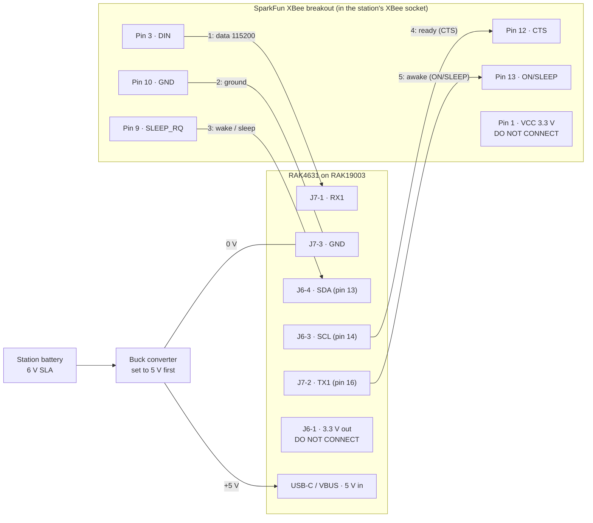

# LoRa link firmware (RAK4631)

Firmware for the XBee replacement planned in [docs/hardware.md](../docs/hardware.md#lora-replacement-plan). One sketch, two roles:

- **Station:** reads the station's 32-byte packets at **115200** 8N1 on UART1 (the station XBee's `BD` = 7; see [XBee configuration](../docs/hardware.md#xbee-configuration)), checks header and CRC, and transmits each valid packet unchanged. It stands in for the XBee's pin-sleep handshake (CTS follows SLEEP_RQ), reports its own health over the air once a minute, and accepts handshake-mode changes over the air, so a wrong guess about the station's controller doesn't mean another ladder trip.
- **Receiver:** receives LoRa packets, checks length, header and CRC, and writes the 32 raw bytes to USB and to UART1 at 9600 8N1. That's the same byte stream an XBee in transparent mode (`AP` = 0) delivers, so `rainwise_logger.py` and the NAS service can read it as is.

| File | What |
| --- | --- |
| `platformio.ini` | PlatformIO project: `station` and `receiver` environments, RadioLib version pinned |
| `rainwise_lora/rainwise_lora.cpp` | The sketch (plain C++ rather than `.ino`, so PlatformIO doesn't have to generate declarations). Board pins and radio settings are in blocks at the top |
| `rainwise_lora/local_config.h.example` | Template for `local_config.h` (gitignored), which holds the private remote-command key |
| `rakwireless/` | RAK4631 board definition and variant files from RAK's RAK_PATCH_V2 ([RAK WisBlock PlatformIO guide][rak-pio]), unchanged. The variant files are LGPL-2.1 (inherited from the Arduino and Adafruit cores); see their headers |
| `replay_packets.py` | Bench test: sends packets from a logger CSV to a station-role board over USB |

Status: builds clean for both roles with PlatformIO (nordicnrf52 11.0.0, Adafruit nRF52 framework 1.7.0, RadioLib 7.8.1); an earlier version also built with arduino-cli (RAK nRF52 core 1.3.3). The CRC and framing code was tested on a PC against all 19,235 packets in a logged CSV, with junk bytes inserted and 1 % of the packets corrupted: every good packet was found and every corrupted one rejected. The status and command message encoding was also tested on a PC (round trip, corrupted message rejected, never mistaken for a weather packet). **On hardware (2026-11-07):** first board flashed as station; replayed packets over USB were all transmitted (`sent 23 dropped 0`). Second board flashed as receiver: replayed packets received with header and CRC intact (`good 19 bad 0`, RSSI -19 dBm, SNR 9.25 dB at a few metres). Status messages and remote commands work over the air (`s`, `1`, `2`, `0` each confirmed within 15 s), and the handshake mode survives a power cycle. Range, UART1 output, the SLEEP_RQ jumper check and the logger end to end not yet tested.

## Radio settings

Every board must use the same values ([RadioLib][radiolib-sx1262]).

| Setting | Value | Why |
| --- | --- | --- |
| Frequency | 919.0 MHz | Between the LoRaWAN US915 uplink channels (902.3-914.9 MHz) and downlink channels (923.3-927.5 MHz), so it stays out of the way of nearby LoRaWAN gateways ([LoRaWAN Regional Parameters RP002][rp002]) and away from Meshtastic's US default near 906.9 MHz |
| Bandwidth | 500 kHz | FCC 15.247 digital modulation needs a 6 dB bandwidth of at least 500 kHz ([47 CFR 15.247][ecfr-15247]). Whether a LoRa 500 kHz signal measures ≥ 500 kHz at the 6 dB points is **verify** |
| Spreading factor | 10 | Starting point. Each step up gains range and roughly doubles airtime (table below) |
| Coding rate | 4/5 | Least overhead; packets are already CRC-protected end to end |
| Sync word | 0x12 (private) | Keeps Meshtastic (0x2B) and LoRaWAN (0x34) packets from being received |
| Power | +22 dBm | SX1262 maximum ([Semtech SX1262][sx1262]). Under the 15.247 limit of 1 W with antennas up to 6 dBi |
| Current limit | 140 mA | Overcurrent protection for +22 dBm ([Semtech SX1262][sx1262] datasheet) |

**Airtime** for one 32-byte packet at 500 kHz, from the Semtech formula ([Semtech forum][lora-toa]). The station also prints the exact value from RadioLib at startup. One packet goes out every 2 s.

| SF | Airtime | Share of the 2 s interval |
| --- | --- | --- |
| 7 | 18 ms | 0.9 % |
| 9 | 62 ms | 3.1 % |
| 10 | 113 ms | 5.7 % |
| 11 | 206 ms | 10.3 % |
| 12 | 412 ms | 20.6 % |

Receiver sensitivity improves about 2.5 dB per SF step. Widening from 125 to 500 kHz costs about 6 dB (10·log10(4)), because the noise floor rises with bandwidth ([Semtech AN1200.22, LoRa Modulation Basics][an1200-22]). Pick the lowest SF that holds the link at the station's distance with margin; the range test below decides it. More airtime also means more transmit current at the station: at SF12 the transmitter is on 20 % of the time.

**Security:** like the XBee link today (`EE` = 0), packets are not encrypted or authenticated. The CRC catches errors, not forgeries. Remote commands must carry a 32-bit key from `local_config.h`, which keeps the public code from controlling your station; the key is sent in the clear, so someone recording the link could replay it. The worst a command can do is change how CTS behaves, which could stop the station's data until it's set back.

## Board pins (RAK4631)

From RAK's core ([RAK-nRF52-Arduino][rak-core], `variants/WisCore_RAK4631_Board/variant.h`, the same pins as `rakwireless/variants/rak4630/variant.h` here) and Meshtastic's RAK4631 variant ([Meshtastic variant.h][mesh-variant]):

| Signal | Pin | Note |
| --- | --- | --- |
| SX1262 NSS / DIO1 / RESET / BUSY | 42 / 47 / 38 / 46 | |
| SX1262 SCK / MISO / MOSI | 43 / 45 / 44 | On its own SPI bus (SPIM2). The core's default `SPI` goes to the WisBlock IO slot, not the radio |
| RF switch power | 37 | Driven HIGH; DIO2 switches TX/RX |
| TCXO | 1.8 V from DIO3 | |
| UART1 RX1 / TX1 | 15 / 16 | RAK19003 header J7 ([RAK19003 datasheet][rak19003]). In the station role TX1 is released from the UART and drives ON/SLEEP |
| Station SLEEP_RQ in / CTS out | 13 / 14 | RAK19003 header J6 SDA / SCL, used as plain GPIO (I2C isn't used). The RAK19003's other IO pins are only on its board-to-board connectors ([RAK19003 datasheet][rak19003]) |
| Green LED | 35 | Blinks once per packet; fast blink = radio failed to start |

UART1 runs at `STATION_UART_BAUD` (115200) in the station role and `RECEIVER_UART_BAUD` (9600) in the receiver role.

**Station handshake.** The station XBee uses pin sleep (`SM` = 1): SLEEP_RQ (socket pin 9) high = sleep, low = awake, and the XBee answers with CTS (pin 12) low when ready ([Digi pin sleep][xbee-pinsleep]). The station role reads SLEEP_RQ on J6 SDA and drives CTS on J6 SCL. SLEEP_RQ has a pull-up, like the XBee's own inputs. Three modes, changeable over the air and remembered across power cycles (stored in the nRF52's internal flash):

| Mode | Key | CTS | ON/SLEEP | Use when |
| --- | --- | --- | --- | --- |
| mirror (default) | `0` | Low while SLEEP_RQ is low (awake), high while asleep, exactly like the XBee | High while awake, low while asleep | Normal; matches what the controller saw before |
| cts-low | `1` | Always low (always ready) | Always high (always awake) | SLEEP_RQ never changes (controller doesn't drive it, or the wire is off) but the controller waits for a ready signal |
| released | `2` | Not driven, as if unconnected | Not driven | The controller doesn't seem to care about either line, or to rule them out |

Which lines the controller really uses is unconfirmed (**verify**); the status message shows it. The station XBee has ON/SLEEP enabled (`D9` = 1), so the controller could be watching pin 13 instead of CTS; the station role drives both. The core's `Serial1.begin()` gives the UART control of TX1, so the firmware disconnects TX1 from the UART afterwards (`releaseUart1Tx()`, per the UARTE chapter of the [nRF52840 Product Specification][nrf52840-ps]) and uses it as a plain output. The status message doesn't report ON/SLEEP; check it with a meter on J7 pin 2 (bench step 6). The LED blink is non-blocking so the 64-byte UART receive buffer can't overflow at 115200.

## Status messages and remote commands

The station sends a 31-byte status message (header `RWS`) at startup, every 60 s, and right after any command. It goes out between weather packets and never reaches the display or the logger: receivers forward only valid 32-byte `33 80 00` packets. In text mode (`d`) a receiver prints it like this:

```
status: up 3600 s, handshake mirror, SLEEP_RQ high (asleep), CTS high, wakes 30 (avg 9 ms, max 12 ms),
weather packets 1800, UART bytes 57600, TX errors 0, dropped 0, commands on, last command 4 | rssi -71 snr 9.5
```

How to read it:

- **wakes about 30 per minute** with a short awake time: the controller drives SLEEP_RQ for every packet, so mirror mode is right.
- **wakes 0 and SLEEP_RQ high** while **weather packets** stay at 0: the controller isn't waking the radio, or the SLEEP_RQ wire is loose. With CTS held high the controller may be waiting; try `1` (cts-low).
- **UART bytes rising but weather packets not**: data arrives but doesn't frame, e.g. wrong baud rate.
- **Weather packets rising**: the link works; the receivers are getting data.

Commands, typed in a receiver's text mode: `0` / `1` / `2` set the handshake mode, `s` asks for status now. The receiver sends the command just after it next hears the station (the station listens between its own transmissions), and the station's reply shows the new mode and the command's sequence number under "last command". If nothing confirms it within a minute, type it again.

Both boards need the same key in `rainwise_lora/local_config.h` (copy `local_config.h.example`; generate a key with `python3 -c "import secrets; print(hex(secrets.randbits(32)))"`). Without the file, the station ignores commands and receivers refuse to send them; the status message says "commands OFF".

## Building and flashing (PlatformIO in VS Code)

PlatformIO downloads the compiler, the Adafruit nRF52 framework, the upload tool (`adafruit-nrfutil`) and the pinned RadioLib version by itself ([PlatformIO `platformio.ini`][pio-ini]). The standard nordicnrf52 platform has no RAK4631 board, so `boards_dir` points at RAK's board files in `rakwireless/` ([RAK WisBlock PlatformIO guide][rak-pio]).

1. The PlatformIO extension only finds a project whose `platformio.ini` is at the top of a workspace folder. Open `lora/` as its own folder, or add it to the workspace with **File > Add Folder to Workspace**.
2. In the PlatformIO sidebar, under **Project Tasks**, pick the **station** or **receiver** environment, then **Build**, **Upload** or **Monitor**. From a terminal in `lora/`:
   ```
   pio run                          # build both roles
   pio run -e station -t upload     # build + flash the station role
   pio run -e receiver -t upload
   pio device monitor               # 115200; keys are sent as you type
   ```
   `pio device list` shows the board's port, usually `/dev/ttyACM0`. Add `--upload-port` if several boards are plugged in. Upload resets the board into its bootloader automatically ("1200 bps touch"). If that fails, double-press the reset button and try again.
3. For the replay script: `pip install pyserial` ([pyserial][pyserial]).
4. For remote commands: create `rainwise_lora/local_config.h` from the example (see above) before building. Every board needs the same file.

Uploading replaces Meshtastic but keeps RAK's bootloader. To go back, drag the Meshtastic UF2 onto the board's USB drive ([RAK4631 Quick Start][rak4631-qs]).

## Bench test (four kits)

Flash one board as **station** (S) and three as **receivers** (R1-R3). Keep them a few metres apart with antennas attached. Never transmit without an antenna, because it can damage the radio.

1. **First link.** Run `pio device monitor -p <R1 port>` and press `d` to switch R1 to text mode. In a second terminal, from the repo root, run `python lora/replay_packets.py <S port> rainwise_log.csv`. R1 should print an `ok` line with RSSI and SNR every 2 s, and the `bad` count should stay at 0.
2. **Logger end to end.** Put R1 back in raw mode (`d` again, or unplug and replug), close the monitor, and run `python rainwise_logger.py --port /dev/ttyACM1 --no-xml` on it. The rows should match the replayed CSV.
3. **Several receivers.** R2 and R3 should count the same packets as R1 at the same time.
4. **UART1 output.** Connect a 3.3 V USB-serial adapter to R1's TX1 and GND, open it at 9600 8N1, and check that the same 32-byte packets come out. This is the output that will feed the Oracle line driver or a local XBee.
5. **Live station data (optional).** If you have a 3.3 V XBee breakout whose DOUT pin you can reach, wire XBee DOUT to S's RX1 and connect the grounds. S then relays the live station packets over LoRa. A receiver-configured XBee outputs at **9600**, so build S with `STATION_UART_BAUD` set to 9600 for this test. Check that both sides are 3.3 V logic first (**verify**).
6. **Status and commands, no station needed.** With S running and R1 in text mode, a status line should appear every minute (`SLEEP_RQ high (asleep)` with nothing connected, because of the pull-up). Briefly connect S's J6 SDA to GND with a jumper: SLEEP_RQ shows `low (awake)`, and removing the jumper counts one wake. Type `1`, `2`, `0` on R1 and check that each reply shows the new mode and command number; measure J6 SCL (CTS) with the VTVM: low in cts-low, floating in released, following SDA in mirror. J7 pin 2 (TX1, ON/SLEEP) is the opposite: about 3.3 V in cts-low, floating in released, and in mirror 0 V with SDA open (asleep) and 3.3 V with SDA jumpered to GND (awake). Power-cycle S and check that the mode was remembered.
7. **Range.** Carry a laptop with a receiver in text mode toward and past the station distance. Note RSSI and SNR, then repeat at other SF values (all boards must change together).

## Station wiring: XBee breakout to RAK19003

Five signal wires plus power. The breakout ([SparkFun BOB-08276][sf-xbee-bob]) plugs into the station's XBee socket in place of the XBee, through 2 mm male headers ([PRT-10112][sf-2mm-header]), and brings the 20 XBee pins out to 0.1" (2.54 mm) holes. Pin names are from Digi's through-hole pinout ([Digi pin signals][xbee-pins-802]); the RAK19003 header pins are from its datasheet ([RAK19003 datasheet][rak19003]).

| Wire | Breakout (XBee pin) | RAK19003 | Signal | Direction |
| --- | --- | --- | --- | --- |
| 1 | **Pin 3** DIN | **J7 pin 1** RX1 | Station data, 115200 8N1 | station → RAK |
| 2 | **Pin 10** GND | **J7 pin 3** GND | Ground | — |
| 3 | **Pin 9** SLEEP_RQ | **J6 pin 4** SDA | Controller wakes / sleeps the radio | station → RAK |
| 4 | **Pin 12** CTS | **J6 pin 3** SCL | "Ready" back to the controller | RAK → station |
| 5 | **Pin 13** ON/SLEEP | **J7 pin 2** TX1 | "Awake" back to the controller | RAK → station |

**Do not connect:**

- Breakout **pin 1** (VCC 3.3 V): the station's 3.3 V supply. The RAK has its own 5 V supply.
- RAK19003 **J6 pin 1** (3.3 V): an *output* from the RAK. Joining it to the station's 3.3 V would put two supplies against each other.
- RAK19003 **J7 pin 4** (BOOT): not used.
- Every other breakout pin, including pin 2 (DOUT), which the XBee drove but the RAK doesn't. The link is one-way.

**Power:** a 5 V buck converter from the station battery feeds the RAK's USB-C (a cut USB cable) or VBUS. Set the buck output to 5 V with the meter *before* connecting it. In a cut USB cable, red is usually +5 V and black is ground, but check with the meter: cable colors aren't guaranteed. The battery's negative and the station's GND (breakout pin 10) are expected to be the same point, so the grounds join through both paths (verify with a continuity check before connecting).



**Where the pins are on the breakout.** Looking down on the XBee (and the breakout, in the same orientation), pin 1 is top-left; pins 1-10 run down the left side and pins 11-20 come back up the right side, so pin 20 sits across from pin 1 ([XBee datasheet pin drawing][xbee-s1-ds]). The five used pins are all near the ends of the rows:

```
                     XBee / breakout, top view
                       ┌─────────────────┐
  do not connect  VCC  1 ●               ● 20
                 DOUT  2 ●               ● 19
   wire 1 ──▶     DIN  3 ●               ● 18
                       4 ●               ● 17
                       5 ●               ● 16
                       6 ●               ● 15
                       7 ●               ● 14
                       8 ●               ● 13  ON/SLEEP ◀── wire 5
   wire 3 ──▶ SLEEP_RQ 9 ●               ● 12  CTS ◀── wire 4
   wire 2 ──▶     GND 10 ●               ● 11
                       └─────────────────┘
```

Pin 9 (SLEEP_RQ) and pin 12 (CTS) sit directly across from each other, one row above GND (pin 10); pin 13 (ON/SLEEP) is just above pin 12. In the station the XBee sits with its antenna end pointing down, so in the socket this drawing is upside down: pin 1 is at the bottom right (see [docs/hardware.md](../docs/hardware.md#station-main-board)). Check the breakout's silkscreen against this before soldering; the SparkFun board marks pin 1 (verify on your board).

## Station install (one trip)

Everything fiddly happens indoors; the ladder part is a swap and a plug.

**Indoors, beforehand:**
1. Solder 2.54 mm header pins or wires to the RAK19003's J6 and J7, and the 2 mm male headers to the SparkFun XBee breakout (both are small parts; use good light and a magnifier).
2. Wire the breakout to the RAK19003 as in [Station wiring](#station-wiring-xbee-breakout-to-rak19003): pin 3 (DIN) to J7 RX1, pin 10 (GND) to J7 GND, pin 9 (SLEEP_RQ) to J6 SDA, pin 12 (CTS) to J6 SCL, pin 13 (ON/SLEEP) to J7 TX1. Leave the breakout's pin 1 (3.3 V) unconnected. Label each wire.
3. Wire the 5 V buck converter's output to the RAK's USB-C (a cut USB cable) or VBUS, and set its output to 5 V with the meter before connecting.
4. Flash the station role and run bench step 6 with this exact assembly. Put it in its enclosure with the antenna attached.

**At the station:**
1. Station power off. Pull the original XBee out of its socket and keep it (it's the fallback).
2. Push the breakout's headers into the XBee socket, same orientation as the XBee (pin 1 to pin 1).
3. Connect the buck converter to the battery. Station power on.
4. Watch the RAK's green LED: one short blink every 2 s means packets are flowing. No blinks: go back indoors and check the status messages on a receiver; change the handshake mode from there if needed. Fast continuous blinking means the radio failed to start.

If anything is wrong and can't be fixed from indoors, the fallback is to put the original XBee back.

## References

- [RadioLib – SX1262 class reference][radiolib-sx1262]: `begin()` parameters (frequency, bandwidth, SF, CR, sync word, power, preamble, TCXO voltage).
- [RAKwireless – RAK-nRF52-Arduino core][rak-core]: board support; `variant.h` gives the UART, LED and default SPI pins.
- [Meshtastic – RAK4631 variant.h][mesh-variant]: SX1262 pins, power-enable pin 37, DIO2 RF switch, 1.8 V TCXO.
- [RAKwireless – RAK19003 datasheet][rak19003]: UART1 on J7, 5 V input limits, J6/J7 pin order.
- [SparkFun – XBee breakout][sf-xbee-bob] and [2 mm XBee header][sf-2mm-header]: plugging into the station's XBee socket.
- [Digi – XBee 802.15.4 pin signals][xbee-pins-802]: pin 3 DIN, 9 SLEEP_RQ, 10 GND, 12 CTS, 13 ON/SLEEP.
- [Digi/SparkFun – XBee Series 1 datasheet][xbee-s1-ds] (PDF): pin drawing, pin 1 top-left, pin 20 top-right.
- [RAKwireless – RAK4631 Quick Start][rak4631-qs]: Arduino setup, bootloader, restoring Meshtastic.
- [Semtech – SX1262][sx1262]: datasheet (output power, overcurrent protection, airtime formula).
- [Semtech – AN1200.22 LoRa Modulation Basics][an1200-22]: sensitivity vs. bandwidth and spreading factor (in the documents list on the SX1276 page).
- [Semtech forum – SX126x time-on-air calculation][lora-toa]
- [Digi – XBee 3 802.15.4 pin sleep][xbee-pinsleep]: SLEEP_RQ and CTS behaviour the station role can mimic.
- [LoRa Alliance – RP002 Regional Parameters][rp002]: US915 channel plan.
- [eCFR – 47 CFR 15.247][ecfr-15247]: 902-928 MHz rules (500 kHz minimum 6 dB bandwidth, power, antenna gain).
- [RAKwireless – WisBlock PlatformIO guide][rak-pio]: RAK_PATCH_V2 board files used in `rakwireless/`.
- [PlatformIO – platformio.ini][pio-ini]: environments, `boards_dir`, `build_src_filter`, `lib_deps`.
- [Nordic – nRF52840 Product Specification][nrf52840-ps]: UARTE pin selection (PSEL registers may only be changed while the UARTE is disabled).
- [Adafruit nRF52 nrfutil][nrfutil]: the upload tool PlatformIO uses for this board.
- [pyserial][pyserial]

[radiolib-sx1262]: https://jgromes.github.io/RadioLib/class_s_x1262.html
[rak-core]: https://github.com/RAKWireless/RAK-nRF52-Arduino
[mesh-variant]: https://github.com/meshtastic/firmware/blob/master/variants/nrf52840/rak4631/variant.h
[rak19003]: https://docs.rakwireless.com/product-categories/wisblock/rak19003/datasheet/
[rak4631-qs]: https://docs.rakwireless.com/product-categories/wisblock/rak4631/quickstart/
[sx1262]: https://www.semtech.com/products/wireless-rf/lora-connect/sx1262
[an1200-22]: https://www.semtech.com/products/wireless-rf/lora-connect/sx1276
[lora-toa]: https://forum.lora-developers.semtech.com/t/sx126x-time-on-air-calculation/127
[xbee-pinsleep]: https://docs.digi.com/resources/documentation/digidocs/90002273/reference/r_mode_pin_sleep.htm
[rp002]: https://resources.lora-alliance.org/technical-specifications/rp002-1-0-4-regional-parameters
[ecfr-15247]: https://www.ecfr.gov/current/title-47/chapter-I/subchapter-A/part-15/subpart-C/section-15.247
[rak-pio]: https://github.com/RAKWireless/WisBlock/blob/master/PlatformIO/README.md
[pio-ini]: https://docs.platformio.org/en/latest/projectconf/index.html
[pyserial]: https://pyserial.readthedocs.io/
[nrfutil]: https://github.com/adafruit/Adafruit_nRF52_nrfutil
[nrf52840-ps]: https://docs.nordicsemi.com/bundle/ps_nrf52840/page/uarte.html
[sf-xbee-bob]: https://www.sparkfun.com/breakout-board-for-xbee-module.html
[sf-2mm-header]: https://sparkfun.com/products/10112
[xbee-pins-802]: https://docs.digi.com/resources/documentation/digidocs/90001500/reference/r_pinouts_802.htm
[xbee-s1-ds]: https://cdn.sparkfun.com/assets/4/9/0/0/f/XBee-Datasheet.pdf
